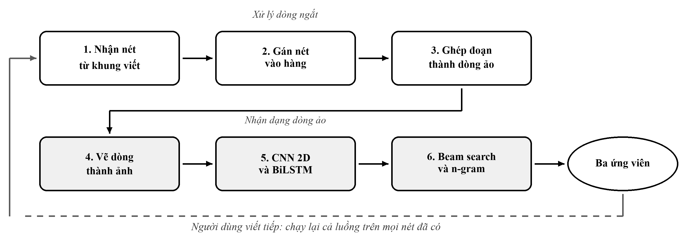
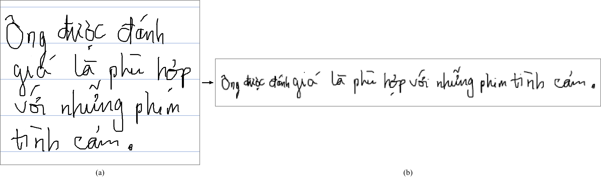

@@phan-chinh
# CHƯƠNG 1. TỔNG QUAN ĐỀ TÀI

Chương này trình bày bối cảnh, mục tiêu, phạm vi của đề tài, phát biểu bài toán và các chỉ số dùng để đánh giá kết quả. Các chương sau dựa trên những định nghĩa và ngưỡng nêu ở đây.

## 1.1. Bối cảnh và lý do chọn đề tài

Nhập văn bản bằng chữ viết tay trên điện thoại và máy tính bảng là cách nhập tự nhiên với nhiều người dùng, nhất là khi gõ bàn phím ảo bất tiện. Với tiếng Việt, bài toán này khó hơn nhiều ngôn ngữ khác vì hệ thống dấu thanh và dấu phụ. Sáu nguyên âm gốc kết hợp với dấu thanh và dấu phụ tạo ra 66 nguyên âm biến thể [@vohtr2018a]. Dấu thanh và dấu phụ thường được viết sau phần thân chữ, tạo thành nét trễ [@nguyen2018]. Google cũng dùng riêng một mô hình cho tiếng Việt vì lượng dấu thanh và dấu phụ này [@carbune2019].

Đề tài có nền tảng tốt để triển khai vì đã có bộ dữ liệu công khai HANDS-VNOnDB, gọi tắt là VNOnDB [@nguyen2018], và kết quả chuẩn từ cuộc thi nhận dạng chữ viết tay tiếng Việt dạng nét (VOHTR) tại Hội nghị quốc tế về nhận dạng chữ viết tay (ICFHR) năm 2018 [@le2018]. Khoảng trống còn lại là ràng buộc của thiết bị. Mô hình cho chữ viết tay dạng ảnh đứng đầu trên VNOnDB có 65,9 triệu tham số [@pham2025], quá lớn cho mục tiêu chạy ngay trên điện thoại mà không cần mạng.

Điểm mới của đề tài là cho phép ngắt dòng khi viết. VNOnDB có 110.746 từ trên 7.296 dòng [@le2019], tức khoảng 15 từ mỗi dòng. Một dòng dài như vậy khó viết liền trên màn hình điện thoại hẹp, nên người dùng thường phải xuống hàng hoặc dừng giữa chừng. Hệ thống cần nhận ra rằng các đoạn viết trên nhiều hàng vẫn thuộc cùng một dòng văn bản.

Từ các lý do trên, đề tài "Nhận dạng chữ viết tay tiếng Việt trên thiết bị cảm ứng" xây dựng hệ thống nhận dạng chữ viết tay tiếng Việt theo dòng, chạy ngay trên điện thoại Android và cho phép ngắt dòng khi viết. Hệ thống nhận chuỗi nét từ khung viết, vẽ dòng thành ảnh rồi nhận dạng ảnh đó. Đầu ra là văn bản tiếng Việt có dấu.

## 1.2. Mục tiêu của đề tài

Đề tài đạt yêu cầu khi mô hình đọc đúng dòng liền, giữ được độ chính xác khi dòng bị ngắt và chạy không cần mạng trên điện thoại. Chỉ số chính là tỷ lệ lỗi ký tự (CER) và tỷ lệ lỗi từ (WER), định nghĩa ở mục 1.5. Bảng {{bang:muc-tieu}} ghi các mục tiêu và ngưỡng của đề tài. Ngưỡng được kiểm tra trên bản chạy trên điện thoại, tức mô hình sau lượng tử hóa kèm bộ giải mã có mô hình ngôn ngữ.

| Mục tiêu | Chỉ số | Ngưỡng |
| --- | --- | --- |
| Nhận dạng dòng liền | CER trên tập kiểm thử VNOnDB cấp dòng | ≤ 8,4% |
| Nhận dạng dòng liền | WER trên tập kiểm thử VNOnDB cấp dòng | ≤ 24,2% |
| Nhận dạng dòng liền, mục tiêu cao hơn | CER trên tập kiểm thử VNOnDB cấp dòng | Tiến gần 7,6% |
| Xử lý dòng ngắt | CER tăng thêm so với cùng dòng viết liền | ≤ 2 điểm phần trăm |
| Chạy trên điện thoại | Tổng dung lượng mô hình và mô hình ngôn ngữ | ≤ 20 MB |
| Phản hồi nhanh | Thời gian nhận dạng một dòng trên điện thoại thật | ≤ 1 giây |
| Viết bằng ngón tay | CER trên tập tự thu | Đo và báo cáo |

Bảng: Mục tiêu và ngưỡng của đề tài {#bang:muc-tieu w=30,45,25}

Đề tài huấn luyện trên chữ viết tay dạng ảnh, nên ngưỡng CER và WER lấy từ các mốc dạng ảnh ở mục 1.5.4. Ngưỡng bằng mốc GFCN, mô hình có 1,4 triệu tham số, nhỏ nhất trong các mốc dạng ảnh, nên hợp với ràng buộc của điện thoại [@pham2025]. Mục tiêu cao hơn lấy theo OrigamiNet và không bắt buộc. Ngưỡng 20 MB ngang kích thước mô hình ML Kit cho mỗi ngôn ngữ [@google2026a].

## 1.3. Phạm vi của đề tài

Hệ thống nhận dạng từng dòng văn bản tiếng Việt, và mỗi dòng được phép viết thành nhiều đoạn. Dòng ngắt là dòng viết không liền mạch: người viết dừng giữa chừng rồi viết tiếp, hoặc xuống hàng khi hết màn hình. Kết quả vẫn là một dòng văn bản liền, đúng thứ tự. Lớp ghép đoạn nối các đoạn thành một dòng ảo, nên mô hình không cần biết dòng đã bị ngắt mấy lần.

### 1.3.1. Nội dung trong phạm vi

- Chữ viết bằng ngón tay hoặc bút cảm ứng trên điện thoại Android.
- Bộ ký tự của VNOnDB, gồm 160 ký tự và nhãn trống của hàm mất mát CTC.
- Ba kiểu ngắt: tạm dừng giữa dòng, xuống hàng khi hết màn hình, và thêm dấu thanh hoặc dấu phụ sau khi đã dừng.
- Nhận dạng ngay trên thiết bị, không cần mạng.

### 1.3.2. Nội dung ngoài phạm vi

- Nhận dạng ảnh chụp chữ viết tay. Mô hình chỉ đọc ảnh do ứng dụng vẽ từ nét.
- Nhận dạng đoạn văn gồm nhiều dòng độc lập.
- Ngắt ở giữa một từ, vì đề tài giả định mỗi lần ngắt rơi vào ranh giới giữa hai từ.
- Viết chồng chữ lên nhau tại cùng một vị trí.
- Bản cho iOS và cá nhân hóa theo từng người viết.

## 1.4. Phát biểu bài toán

Bài toán là ánh xạ ảnh của một dòng thành một chuỗi ký tự, không cần căn chỉnh trước giữa cột ảnh và ký tự. Bảng {{bang:bai-toan}} tóm tắt đầu vào, đầu ra và ràng buộc của bài toán.

| Thành phần | Mô tả |
| --- | --- |
| Đầu vào của hệ thống | Chuỗi nét theo thứ tự viết, mỗi nét là một dãy điểm $(x, y)$ |
| Đầu vào của mô hình | Ảnh xám của một dòng liền hoặc dòng ảo, do ứng dụng vẽ từ nét |
| Đầu ra | Chuỗi ký tự tiếng Việt, kèm ba ứng viên tốt nhất để người dùng chọn |
| Hàm mất mát | CTC, vì dữ liệu không có nhãn căn chỉnh theo từng cột ảnh [@graves2006] |
| Ràng buộc | Chạy không cần mạng trên điện thoại, đạt các ngưỡng ở Bảng {{bang:muc-tieu}} |

Bảng: Phát biểu bài toán {#bang:bai-toan w=28,72}

Hệ thống gồm hai phần: lớp ghép đoạn đưa dòng ngắt về dạng dòng liền, rồi mô hình CTC nhận dạng ảnh của dòng đó. Cách chia này cho phép huấn luyện mô hình trên VNOnDB, dù bộ dữ liệu không được thu cho kiểu viết xuống hàng. Hình {{hinh:luong}} cho thấy luồng xử lý một dòng. Ba bước đầu xử lý dòng ngắt, ba bước sau nhận dạng dòng ảo. Khi người dùng viết tiếp, ứng dụng chạy lại cả luồng trên mọi nét đã có.

{#hinh:luong rong=16}

Khung viết có hàng kẻ sẵn, nên mỗi nét được gán vào một hàng. Lớp ghép đoạn nối các hàng thành một dòng ảo, đưa về cùng cỡ chữ và chèn khoảng cách chuẩn giữa các đoạn. Bước này dùng quy tắc hình học, không cần huấn luyện. Hình {{hinh:dong-ngat}} là một dòng ngắt thật trong tập tự thu và ảnh dòng ảo mà mô hình nhận được sau khi ghép. Bảng {{bang:kieu-ngat}} ghi cách xử lý từng kiểu ngắt.

{#hinh:dong-ngat rong=15}

| Kiểu ngắt | Tác động lên dữ liệu vào | Cách xử lý |
| --- | --- | --- |
| Tạm dừng giữa dòng | Không đổi, vì ảnh không chứa thời gian | Nhận dạng lại sau mỗi lần dừng, chỉ chốt dòng khi người dùng bấm Xong |
| Xuống hàng khi hết màn hình | Các đoạn nằm trên nhiều hàng | Gán nét theo hàng rồi ghép thành dòng ảo |
| Thêm dấu thanh hoặc dấu phụ sau khi đã dừng | Xuất hiện nét trễ, viết sau nhưng nằm đúng chỗ trên hàng | Gán nét trễ vào đúng hàng, vì ảnh của dòng không phụ thuộc thứ tự viết |

Bảng: Các kiểu ngắt và cách xử lý {#bang:kieu-ngat w=26,34,40}

Kiểu ngắt thứ ba không còn khó với mô hình, vì nét trễ nằm đúng chỗ trên ảnh. Phần khó chuyển sang bước gán nét vào hàng, trình bày ở mục 3.2.2.

## 1.5. Chỉ số và kịch bản đánh giá

### 1.5.1. Tỷ lệ lỗi ký tự và tỷ lệ lỗi từ

Tỷ lệ lỗi dựa trên khoảng cách sửa Levenshtein giữa chuỗi đúng và chuỗi mô hình đọc ra. Đề tài tính theo hai cách, vì các nguồn dùng cách tính khác nhau. Cách thứ nhất, gọi là CER (1), lấy tổng lỗi chia cho tổng độ dài:

$$\mathrm{CER}_{\text{tổng}} = \frac{\sum_{q=1}^{Q} E_q}{\sum_{q=1}^{Q} N_q}$$ {#ct:cer-tong}

trong đó $Q$ là số dòng, $E_q$ là khoảng cách sửa của dòng thứ $q$, bằng tổng số ký tự bị thay, chèn và xóa $S + I + D$ của dòng đó, và $N_q$ là số ký tự của chuỗi đúng ở dòng thứ $q$. Cách thứ hai, gọi là CER (2), tính tỷ lệ của từng dòng rồi lấy trung bình, là cách Le và cộng sự dùng [@le2019]:

$$\mathrm{CER}_{\text{dòng}} = \frac{1}{Q} \sum_{q=1}^{Q} \frac{E_q}{N_q}$$ {#ct:cer-dong}

Hai cách cho kết quả khác nhau khi độ dài dòng khác nhau. Giả sử có hai dòng: dòng thứ nhất có $N_1 = 10$ và $E_1 = 1$, dòng thứ hai có $N_2 = 100$ và $E_2 = 5$. Công thức ({{ct:cer-tong}}) cho 6/110, khoảng 5,45%, còn công thức ({{ct:cer-dong}}) cho trung bình của 10% và 5%, tức 7,5%. Đề tài dùng CER (2) để so với ngưỡng và các mốc so sánh, và báo cáo thêm CER (1). Chuỗi đúng và chuỗi đọc ra đều được chuẩn hóa trước theo mục 3.1.3, và khoảng trắng được tính là một ký tự.

WER tính theo hai công thức trên, với đơn vị là từ thay cho ký tự, ký hiệu là WER (1) và WER (2). Từ được tách theo khoảng trắng, nên trong tiếng Việt, WER thực chất là tỷ lệ lỗi âm tiết.

### 1.5.2. Tỷ lệ lỗi bỏ dấu và mức tăng khi dòng bị ngắt

Để biết phần lỗi do dấu, đề tài đo lại CER sau khi biến đổi cả hai chuỗi theo hai mức:

- **CER bỏ dấu thanh:** bỏ sắc, huyền, hỏi, ngã, nặng và giữ ă, â, ê, ô, ơ, ư, đ.
- **CER bỏ dấu thanh và dấu phụ:** đưa toàn bộ chữ về 26 chữ cái Latinh cơ bản.

Phần chênh giữa CER thường và CER của từng mức cho biết tỷ lệ lỗi do dấu thanh, và do dấu thanh cùng dấu phụ.

Mức tăng khi dòng bị ngắt là hiệu giữa CER của dòng ngắt và CER của chính các dòng đó khi viết liền, tính bằng điểm phần trăm. Hai phép đo dùng cùng một mô hình và cùng một danh sách dòng. Mức tăng được báo theo từng số lượng chỗ nối.

### 1.5.3. Dung lượng, độ trễ và độ bất định

Dung lượng là tổng kích thước các tệp mô hình, bộ ký tự và mô hình ngôn ngữ mà ứng dụng cần khi chạy. Độ trễ là thời gian từ lúc nhấc ngón tay lần cuối đến khi kết quả hiện ra, gồm ghép đoạn, vẽ dòng thành ảnh, chạy mô hình và giải mã. Độ trễ được đo trên điện thoại Android thật, báo cáo trung vị, phân vị 95 và thời gian của dòng dài nhất.

Tập đánh giá viết bằng ngón tay của đề tài có 19 người viết, nên kết quả trên tập này cần kèm khoảng tin cậy. Đề tài dùng bootstrap 95% với đơn vị lấy mẫu lại là người viết. Khi so sánh dòng liền với dòng ngắt, phép so sánh ghép cặp trên cùng một người viết.

### 1.5.4. Kịch bản kiểm thử và mốc so sánh

Bảng {{bang:kich-ban}} ghi ba kịch bản kiểm thử. Dữ liệu của từng kịch bản được trình bày ở mục 3.1.

| Kịch bản | Dữ liệu | Câu hỏi cần trả lời |
| --- | --- | --- |
| Dòng liền | 1.634 dòng kiểm thử của VNOnDB | Mô hình đứng ở đâu so với các mốc đã công bố? |
| Ngắt mô phỏng | Dòng liền của tập đánh giá trong tập tự thu, cắt 2, 4 hoặc 6 lần tại ranh giới từ | Lớp ghép đoạn làm CER tăng bao nhiêu? |
| Viết tay thật | Tập đánh giá của tập tự thu, mỗi người 10 dòng liền và 10 dòng ngắt | Kết quả có giữ được khi viết bằng ngón tay? |

Bảng: Ba kịch bản kiểm thử {#bang:kich-ban w=18,46,36}

Hai kịch bản Ngắt mô phỏng và Viết tay thật báo thêm mốc nhận dạng từng hàng rồi nối chuỗi, để so với cách ghép thành dòng ảo. Kịch bản Ngắt mô phỏng dùng tập tự thu vì bản ảnh của VNOnDB không có nét để cắt. Đề tài không đặt kịch bản riêng cho nét trễ, vì ảnh của dòng không phụ thuộc thứ tự viết. Lớp ghép đoạn vẫn phải gán nét trễ vào đúng hàng, và kịch bản Viết tay thật kiểm tra điều này.

Bảng {{bang:moc}} ghi các mốc so sánh, tất cả đều đo trên tập kiểm thử 1.634 dòng của VNOnDB. Các nguồn không nêu cách tính trung bình của tỷ lệ lỗi, nên số liệu chỉ mang tính tham khảo. Đề tài so trực tiếp với các mốc dạng ảnh, còn các mốc dạng nét chỉ để đối chiếu vì đầu vào khác.

| Hệ thống | Dạng dữ liệu | CER (%) | WER (%) | Ghi chú |
| --- | --- | --- | --- | --- |
| MyScriptTask2_1 [@le2019] | Nét | 1,02 | 2,02 | Mô hình ngôn ngữ dùng VieTreeBank |
| IVTOVTask2 [@le2019] | Nét | 3,24 | 14,11 | 2 lớp BiLSTM 100 ô, ràng buộc từ điển lấy từ VieTreeBank |
| HTR-ConvText [@pham2025] | Ảnh | 3,45 | 8,9 | 65,9 triệu tham số |
| HTR-VT [@pham2025] | Ảnh | 4,26 | 11,2 | 53,5 triệu tham số |
| GoogleTask2 [@le2019] | Nét | 6,86 | 19,00 | Không huấn luyện trên VNOnDB [@carbune2019] |
| OrigamiNet [@pham2025] | Ảnh | 7,6 | 22,6 | 39,1 triệu tham số |
| GFCN [@pham2025] | Ảnh | 8,4 | 24,2 | 1,4 triệu tham số |
| CNN và BiLSTM [@pham2025] | Ảnh | 10,53 | 29,1 | 8,3 triệu tham số |

Bảng: Mốc so sánh trên tập kiểm thử VNOnDB {#bang:moc w=27,13,11,11,38 can=t,g,p,p,t co=12}

MyScript và IVTOV khó làm mục tiêu vì cả hai đều dùng VieTreeBank, cùng nguồn với văn bản kiểm thử [@le2019]. Cuộc thi còn có một tập kiểm thử riêng gồm 15 người viết mới [@vohtr2018b]. Trên tập này, CER của IVTOV tăng từ 3,2% lên 5,6%, và CER của Google tăng từ 6,9% lên 10,3% [@carbune2019]. Vì vậy, tập tự thu của đề tài dùng người viết không có trong VNOnDB.

## 1.6. Sản phẩm đầu ra

Sản phẩm cuối là ứng dụng Android nhận dạng được dòng ngắt khi tắt mạng, kèm mô hình, mã nguồn và báo cáo đánh giá. Bảng {{bang:san-pham}} ghi nội dung và điều kiện hoàn thành của từng sản phẩm.

| Sản phẩm | Nội dung | Điều kiện hoàn thành |
| --- | --- | --- |
| Ứng dụng Android | Khung viết có hàng kẻ, kết quả tạm thời, ba ứng viên | Nhận dạng được dòng ngắt khi tắt mạng |
| Mô hình | Tệp `.tflite`, bộ ký tự và mô hình ngôn ngữ | Tổng dung lượng không quá 20 MB |
| Mã nguồn | Tiền xử lý, vẽ ảnh, mô phỏng ngắt, huấn luyện, đánh giá, ứng dụng | Chạy lại được kết quả theo hướng dẫn |
| Tập tự thu | Nét viết tay và nhãn, không kèm thông tin cá nhân | Đủ cho nhóm chỉnh và tập đánh giá |
| Báo cáo đánh giá | Kết quả ba kịch bản, phân tích lỗi dấu, so sánh với các mốc | Có số liệu cho các ngưỡng ở Bảng {{bang:muc-tieu}} |

Bảng: Sản phẩm đầu ra của đề tài {#bang:san-pham w=20,44,36}

## 1.7. Bố cục báo cáo

Ngoài chương này, báo cáo gồm bốn chương và phần kết luận:

- **Chương 2** trình bày cơ sở lý thuyết: nhận dạng dòng chữ viết tay dạng ảnh, vẽ nét thành ảnh, mạng tích chập hai chiều, LSTM và BiLSTM, hàm mất mát CTC, beam search với mô hình ngôn ngữ n-gram, và lượng tử hóa mô hình.
- **Chương 3** trình bày dữ liệu và thiết kế hệ thống: bộ dữ liệu VNOnDB, tiền xử lý, tập tự thu, lớp ghép đoạn, mô hình nhận dạng, mô hình ngôn ngữ và bộ giải mã.
- **Chương 4** trình bày thực nghiệm: các thí nghiệm, cách chọn cấu hình, kết quả trên tập kiểm thử VNOnDB và trên tập đánh giá viết bằng ngón tay.
- **Chương 5** trình bày việc triển khai trên Android: chuyển đổi mô hình, cấu trúc ứng dụng và kiểm tra.
- **Phần kết luận** tổng kết kết quả so với mục tiêu và nêu hướng phát triển.
