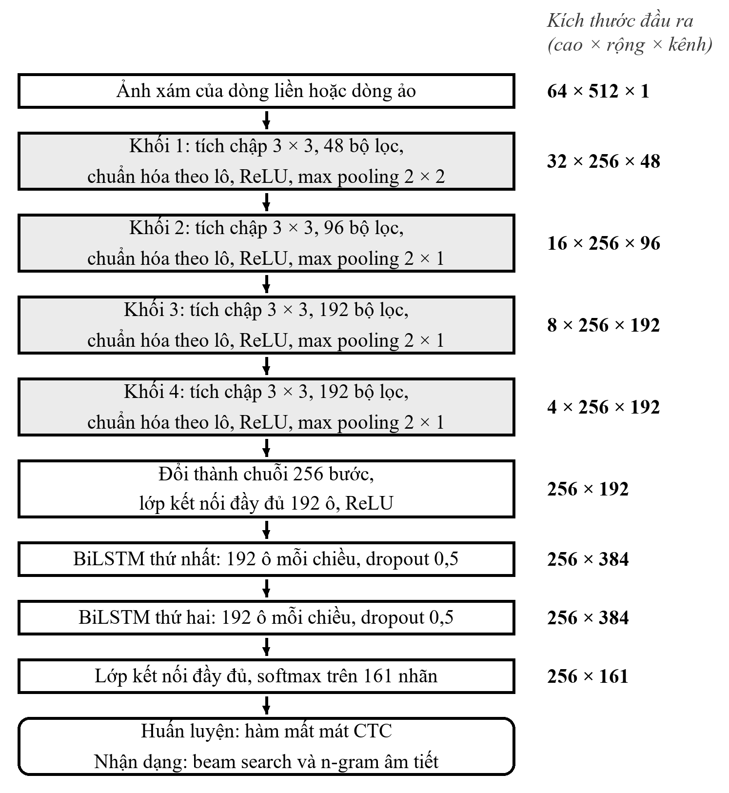

# CHƯƠNG 3. DỮ LIỆU VÀ THIẾT KẾ HỆ THỐNG

Chương này trình bày dữ liệu dùng để huấn luyện và đánh giá, cách tiền xử lý, tập tự thu viết bằng ngón tay, rồi thiết kế của từng thành phần trong luồng xử lý: lớp ghép đoạn, bước vẽ dòng thành ảnh, mô hình nhận dạng, mô hình ngôn ngữ và bộ giải mã.

## 3.1. Dữ liệu

### 3.1.1. Các nguồn dữ liệu

Đề tài huấn luyện mô hình trên chữ viết tay dạng ảnh của bộ dữ liệu VNOnDB. Các tệp nét gốc không tải được, vì trang của bộ dữ liệu [@iapr2026] không truy cập được và đề tài không xin được từ nhóm tác giả. Ứng dụng vẫn thu nét và vẫn ghép dòng ngắt, sau đó vẽ dòng thành ảnh để đưa vào mô hình. Bảng {{bang:nguon}} ghi vai trò và quy mô của từng nguồn.

| Nguồn | Vai trò | Quy mô |
| --- | --- | --- |
| Bản ảnh VNOnDB cấp dòng | Huấn luyện, kiểm định và kiểm thử | 7.296 ảnh kèm nhãn |
| Danh sách chia tập `train.ln`, `val.ln`, `test.ln` | Chia tập huấn luyện, tập kiểm định, tập kiểm thử | 3 danh sách tên tệp |
| Wikipedia tiếng Việt | Kho văn bản của mô hình ngôn ngữ, nguồn câu đề của tập tự thu | Bản sao toàn bộ bài viết [@wikimedia2026a] |
| Tập tự thu | Chọn mô hình, chỉnh ngưỡng lớp ghép đoạn, đánh giá viết bằng ngón tay | Hai buổi thử, nhóm chỉnh 9 buổi, tập đánh giá 19 buổi |
| Dòng ngắt mô phỏng | Đo mức tăng CER do lớp ghép đoạn | Sinh tự động từ dòng liền của tập tự thu |

Bảng: Các nguồn dữ liệu và vai trò {#bang:nguon w=27,40,33}

### 3.1.2. Bộ dữ liệu VNOnDB

Bộ dữ liệu VNOnDB gồm 1.146 đoạn văn và 7.296 dòng do 200 người viết [@vohtr2018a]. Bản gốc lưu nét theo định dạng InkML. Đề tài dùng bản đã vẽ thành ảnh, gồm 7.296 dòng. Cách chia lấy từ các danh sách của kho mã HTR-ConvText [@dairgroup2026], có số dòng trùng với bản chia của cuộc thi VOHTR [@le2019]. Đề tài không chia lại, để kết quả so sánh được với các công bố. Bảng {{bang:vnondb}} ghi quy mô của từng tập do đề tài đếm trực tiếp trên bản ảnh.

| Đại lượng | Tập huấn luyện | Tập kiểm định | Tập kiểm thử | Tổng |
| --- | --- | --- | --- | --- |
| Số dòng | 4.433 | 1.229 | 1.634 | 7.296 |
| Số ký tự cấp dòng | 298.212 | 83.806 | 111.393 | 493.411 |
| Số từ | 66.991 | 18.640 | 25.115 | 110.746 |
| Số mã người viết | 106 | 34 | 60 | 200 |

Bảng: Thống kê bản ảnh VNOnDB theo từng tập {#bang:vnondb w=28,18,18,18,18 can=t,p,p,p,p}

Số dòng, số từ và số ký tự của hai tập đầu khớp với Le và cộng sự [@le2019]. Tập kiểm thử có 111.393 ký tự, ít hơn con số 112.769 của nguồn này 1.376 ký tự. Mỗi dòng có trung bình khoảng 15 từ và 68 ký tự. Mỗi từ có trung bình khoảng 3,3 ký tự, nên "từ" của VNOnDB tương ứng với âm tiết. Nhãn cấp dòng dùng 161 ký tự khác nhau, trong đó 160 ký tự có ở tập huấn luyện hoặc tập kiểm định.

Một số đặc điểm của bộ dữ liệu chi phối thiết kế của hệ thống:

- **Không có nét:** bản ảnh không có tọa độ, thứ tự viết và điểm nhấc bút. Đầu vào của mô hình vì thế là ảnh của dòng.
- **Ảnh vẽ từ nét:** ảnh có nền trắng và nét khử răng cưa, không phải ảnh chụp giấy. Ứng dụng vẽ được ảnh tương tự từ nét thu trên điện thoại.
- **Ảnh đã co vừa khung:** 7.288 trong 7.296 ảnh dòng rộng đúng 523 điểm ảnh. Chiều cao từ 40 đến 396 điểm ảnh, và trên mẫu 400 ảnh, nét chữ chiếm trung vị 52% chiều cao ảnh.
- **Thu bằng bút:** người viết dùng bút trên máy tính bảng ở tần số 120 Hz [@vohtr2018a], khác với ngón tay trên điện thoại.
- **Văn bản từ VieTreeBank:** người viết chép văn bản lấy từ kho VieTreeBank [@le2019], nên các biện pháp chống rò rỉ ở mục 3.1.5 phải tính đến nguồn chung này.

Dữ liệu được cấp theo giấy phép Creative Commons cho mục đích học thuật và nghiên cứu, không cho dùng thương mại [@vohtr2018a]. Đề tài không đưa dữ liệu vào kho mã, chỉ lưu danh sách tệp của từng tập, và ghi rõ nguồn của bản ảnh và của danh sách chia tập.

### 3.1.3. Tiền xử lý

Một quy trình tiền xử lý dùng chung cho cả huấn luyện và ứng dụng. Trên điện thoại, quy trình này chạy sau lớp ghép đoạn, nên đầu vào luôn là một dòng liền hoặc một dòng ảo. Bản Python và bản Kotlin cho cùng kết quả trên một bộ mẫu kiểm tra chung, theo mục 5.3.

Nhãn của VNOnDB, kho văn bản của mô hình ngôn ngữ, nhãn của tập tự thu và chuỗi đọc ra khi chấm điểm đều qua cùng một bước chuẩn hóa. Nếu không, tỷ lệ lỗi sẽ bị đội lên và mô hình ngôn ngữ sẽ đếm một âm tiết thành hai. Các bước gồm:

1. Đưa chuỗi về dạng chuẩn NFC.
2. Thống nhất vị trí dấu thanh theo kiểu cũ, ví dụ "hòa" và "thủy".
3. Thay nhiều khoảng trắng liền nhau bằng một khoảng trắng và bỏ khoảng trắng ở hai đầu.

Bước chuẩn hóa nhãn không đổi chữ hoa, chữ thường và dấu câu.

Ảnh huấn luyện và ảnh do ứng dụng vẽ cùng qua các bước chuẩn hóa ảnh sau:

1. Chuyển ảnh về một kênh xám và đảo ảnh để nét có giá trị lớn.
2. Cắt lề theo khung bao của nét.
3. Co ảnh giữ nguyên tỷ lệ để ảnh nằm trong khung rộng 512, cao 64 điểm ảnh, chừa lề 8 điểm ảnh ở hai bên, theo công thức ({{ct:d2-3}}).
4. Thêm nền vào phần còn thiếu của khung.

Cỡ khung lấy theo Pham và cộng sự [@pham2025]. Lệch giữa ảnh huấn luyện và ảnh vẽ trên điện thoại là rủi ro lớn nhất của hướng đọc ảnh, nên đề tài dùng hai biện pháp. Thứ nhất, bước vẽ của ứng dụng dùng cùng thuật toán với bộ vẽ lại ảnh huấn luyện, theo mục 3.2.3. Thứ hai, tăng cường dữ liệu làm mô hình bớt phụ thuộc vào cách vẽ.

Tăng cường chỉ áp dụng cho tập huấn luyện. Cấu hình cuối gồm các phép biến đổi hình học, tức co giãn, nghiêng và dịch dọc cả dòng mà không để nét rơi khỏi khung, cùng hệ số trộn dày mỏng nét. Ngoài ra, mỗi ảnh huấn luyện được vẽ lại từ khung xương với độ dày nét 0,8; 1,2 và 1,6, kèm hệ số độ đậm từ 0,5 đến 2,5, và mỗi lần dùng một dòng, vòng huấn luyện chọn ngẫu nhiên ảnh gốc hoặc một trong ba ảnh vẽ lại. Mức cụ thể của từng phép nằm ở mục 2.2.7. Cấu hình cuối không dùng giới hạn chiều cao phần nét và biến dạng đàn hồi, vì hai thay đổi này không giúp trên nét viết thật, theo mục 4.4.

### 3.1.4. Dòng ngắt mô phỏng

Bộ mô phỏng sinh dòng ngắt từ dòng liền của tập tự thu, vì bản ảnh VNOnDB không có nét để cắt. Bộ mô phỏng chạy qua đúng các bước mà ứng dụng dùng, nên lỗi gán nét vào hàng cũng được tính vào kết quả. Các bước như sau:

1. Chọn 2, 4 hoặc 6 ranh giới từ làm chỗ ngắt. Trong các buổi thử, một dòng ngắt dài 15 hoặc 16 âm tiết chiếm từ 4 đến 8 hàng.
2. Tách các nét của dòng thành các đoạn tại chỗ ngắt.
3. Đặt mỗi đoạn lên một hàng của khung kẻ ảo.
4. Thêm lệch cỡ chữ và lệch đường chân chữ riêng cho từng đoạn.
5. Chạy bước gán nét vào hàng và lớp ghép đoạn để tạo dòng ảo.
6. Vẽ dòng ảo thành ảnh theo mục 3.2.3.

Bước 4 là bắt buộc. Nếu chỉ dịch các đoạn rồi ghép lại, lớp ghép đoạn sẽ trả về đúng dữ liệu gốc và kết quả sẽ đẹp giả tạo.

### 3.1.5. Chống rò rỉ dữ liệu

Các tập dùng chung người viết hoặc văn bản sẽ làm kết quả cao hơn thực tế. Đề tài áp dụng các biện pháp sau:

- **Người viết:** trường thứ hai của tên tệp ảnh không có giá trị nào xuất hiện ở hai tập. Trường này có đúng 200 giá trị, bằng số người viết, nên đề tài suy ra đây là mã người viết, dù nguồn chưa xác nhận.
- **Câu trùng:** cả 200 người đều chép từ VieTreeBank. Có 146 trong 1.634 dòng kiểm thử (8,9%) và 88 trong 1.229 dòng kiểm định (7,2%) có văn bản giống hệt một dòng huấn luyện. Mục 4.6 báo thêm CER trên 1.488 dòng kiểm thử còn lại.
- **Mô hình ngôn ngữ:** học từ văn bản của tập huấn luyện và Wikipedia tiếng Việt, là kho văn bản ngoài VieTreeBank. Các câu trùng với tập kiểm định, tập kiểm thử và câu đề của tập tự thu bị loại khỏi kho, theo mục 3.2.5.
- **Chỉnh tham số:** trọng số của mô hình ngôn ngữ chỉ được chỉnh trên tập kiểm định. Ngưỡng của lớp ghép đoạn và độ dày nét chỉ được chỉnh trên nhóm chỉnh của tập tự thu.
- **Tập kiểm thử và tập đánh giá:** chỉ được đo một lần ở cuối, sau khi đã chốt mô hình và mọi tham số.

### 3.1.6. Tập tự thu

Tập tự thu là nguồn dữ liệu nét duy nhất của đề tài, và là thước đo cuối cho việc viết bằng ngón tay trên điện thoại. Tập này không dùng để huấn luyện. Người viết đều là người không có trong VNOnDB, và dữ liệu gồm ba phần:

- **Buổi thử:** hai buổi viết bằng bút S Pen của 6 người, dùng để chọn mô hình ở mục 4.4.
- **Nhóm chỉnh:** 9 buổi viết bằng ngón tay của đợt thu đầu và đợt thu thứ hai, dùng để chỉnh ngưỡng của lớp ghép đoạn và độ dày nét.
- **Tập đánh giá:** 19 buổi viết bằng ngón tay của đợt thu thứ ba, mỗi buổi một người, chỉ được đo một lần với cấu hình đã chốt.

Dữ liệu được thu bằng công cụ thu nét là một trang web chạy trên điện thoại của người viết. Mỗi người viết 20 câu đề, gồm 10 dòng liền và 10 dòng ngắt. Dòng liền viết trên khung cuộn ngang, dòng ngắt viết trên khung có hàng kẻ cao 12 mm, bằng khung viết của ứng dụng. Người tham gia cầm dọc điện thoại, viết bằng ngón tay và chép đúng từng chữ của câu đề. Người viết thuộc một trong hai nhóm đổi chéo A và B. Hai nhóm viết cùng 20 câu đề nhưng đổi chéo câu nào viết liền và câu nào viết ngắt, để so sánh dòng liền với dòng ngắt được công bằng.

Câu đề lấy từ các bài Wikipedia tiếng Việt được giữ riêng và đã bị loại khỏi kho văn bản của mô hình ngôn ngữ. Mỗi bài cho tối đa một câu, và mỗi câu dài từ 11 đến 15 âm tiết. Văn bản Wikipedia được cấp theo giấy phép Creative Commons Attribution-ShareAlike 4.0 [@wikimedia2026b], nên khi công bố tập tự thu phải ghi nguồn của câu đề và giữ giấy phép tương ứng.

Công cụ thu tự cấp cho mỗi người một mã ngẫu nhiên dạng NV và 4 ký tự, không có ô nào để nhập tên, và khóa câu đề, cỡ hàng cùng cách nhập bằng ngón tay. Để hàng kẻ cao đúng 12 mm trên mọi máy, công cụ tìm chiều rộng thật của màn hình. Với iPhone, công cụ nhận đời máy từ kích thước màn hình và tỷ lệ điểm ảnh. Với Android, công cụ đọc mã máy rồi tính chiều rộng từ đường chéo và độ phân giải. Khi không nhận ra máy, người thu đo bằng một thẻ chuẩn ID-1 cao 85,60 mm đặt lên màn hình. Tệp thu lưu tọa độ, thứ tự nét, thời điểm của từng điểm và thông tin màn hình. Người tham gia ký phiếu đồng ý trước khi viết, và phiếu không ghi mã của người viết.

Người thu chọn Chép đúng hoặc Chép khác cho từng dòng trên màn rà soát của công cụ. Vì người thu thường bỏ sót các dòng chép khác đề, đề tài xem lại mọi dòng trên ảnh vẽ từ nét gốc trước khi dùng một tệp. Dòng có nội dung khác câu đề bị loại, kể cả dòng có chữ thừa hay chữ bị gạch. Dòng chỉ khác dấu câu và dòng có nét lạc do chạm nhầm được giữ, vì người dùng thật cũng có thể chạm nhầm. Số buổi, số dòng bị loại và kết quả của từng phần nằm ở mục 4.5.

## 3.2. Thiết kế hệ thống

### 3.2.1. Tổng quan

Hệ thống có một luồng xử lý chung cho Python và Kotlin, theo Hình {{hinh:luong}}. Mã Python là bản tham chiếu dùng để huấn luyện và đánh giá, và mã Kotlin trong ứng dụng phải cho cùng kết quả. Bảng {{bang:vi-tri-ma}} ghi mỗi thành phần nằm ở tệp nào.

| Thành phần | Bản Python | Bản Kotlin |
| --- | --- | --- |
| Gán nét vào hàng, ghép đoạn, vẽ ảnh | `training/ink.py` | `Ink.kt` |
| Mô hình ngôn ngữ | `training/lm_binary.py`, `training/char_ngram.py` | `NGramModel.kt`, `CharNGramModel.kt` |
| Bộ giải mã | `training/decoder.py`, `training/decoder_char.py` | `CtcDecoder.kt` |
| Mô hình nhận dạng | `training/model.py` | `Recognizer.kt`, chạy tệp `.tflite` |

Bảng: Vị trí mã của từng thành phần {#bang:vi-tri-ma w=40,30,30}

### 3.2.2. Lớp ghép đoạn

Lớp ghép đoạn gán nét theo thứ tự viết, không dựa vào đường kẻ. Người viết đi hết hàng này mới sang hàng sau, nên các nét của một dòng chữ đứng liền nhau trong thứ tự viết. Lớp ghép đoạn duyệt các nét theo thứ tự và so mỗi nét với dòng chữ đang viết. Dòng chữ có đỉnh thân chữ và đường chân chữ là phân vị 15 và phân vị 85 của tọa độ $y$, và chiều cao thân chữ là hiệu của hai giá trị này. Một nét mở dòng chữ mới khi nét cao ít nhất 0,4 lần chiều cao thân chữ và thỏa một trong hai điều kiện:

- Tâm của nét thấp hơn đường chân chữ quá 1,2 lần chiều cao thân chữ.
- Tâm của nét thấp hơn đường chân chữ quá 0,5 lần chiều cao thân chữ, và điểm trái nhất của nét nằm bên trái mép phải của dòng quá 2 lần chiều cao thân chữ.

Điều kiện thứ hai bắt được chỗ người viết quay về đầu hàng mới. Chân chữ của g và y được viết ngay sau chữ, nằm thấp nhưng không lùi về trái, nên ở lại dòng đang viết. Nét dẹt như dấu chấm, dấu nặng và gạch ngang không mở được dòng mới, kể cả khi người viết quay lại thêm dấu nặng cho từ đầu hàng. Nét có tâm cao hơn đỉnh thân chữ quá 1,2 lần chiều cao thân chữ được gán về một dòng trước, nếu tâm nét nằm trên đường chân chữ của dòng đó và gần đỉnh thân chữ của dòng đó hơn. Trường hợp này là dấu viết bổ sung cho dòng trên.

Lớp ghép đoạn chạy hai lượt. Lượt đầu lấy chiều cao thân chữ của dòng đang viết, kẹp trong khoảng từ 0,6 đến 1,5 lần giá trị dự đoán bằng 0,35 lần chiều cao hàng kẻ, để dòng mới có ít nét không bị ước lượng sai. Lượt sau dùng chung cho mọi dòng trung vị chiều cao thân chữ của các dòng tìm được ở lượt đầu. Cách gán này vẫn đúng khi người viết không theo đường kẻ, ví dụ viết hai dòng chữ trong một hàng kẻ cao.

Sau khi gán, mỗi dòng chữ tạo thành một đoạn. Lớp ghép đoạn lấy trung vị chiều cao thân chữ của các đoạn làm cỡ chữ chung, rồi thực hiện các bước sau cho từng đoạn theo thứ tự viết:

1. Thu các khoảng trống ngang rộng hơn 2 lần chiều cao thân chữ của đoạn về 0,7 lần. Khoảng trống này thường xuất hiện khi người viết cuộn khung viết rồi viết tiếp ở chỗ mới.
2. Co giãn đoạn về cỡ chữ chung, với hệ số co giãn trong khoảng từ 0,7 đến 1,4.
3. Đưa đường chân chữ của đoạn về cùng một độ cao.
4. Đặt đoạn tiếp theo sau đoạn trước, cách 0,7 lần chiều cao thân chữ.

Dòng liền cũng đi qua lớp ghép đoạn như một dòng ảo chỉ có một đoạn, nên cũng được thu khoảng trống. Kết quả là dòng ảo, vẫn giữ các nét riêng biệt để bước sau vẽ thành ảnh. Bảng {{bang:tham-so-ghep}} ghi các tham số của lớp ghép đoạn. Các giá trị này được chọn trên hai buổi thử viết bằng bút, rồi giữ nguyên sau khi kiểm tra trên nhóm chỉnh, theo mục 4.5.

| Tham số | Giá trị | Ý nghĩa |
| --- | --- | --- |
| Mở dòng mới | 1,2 | Độ thấp của tâm nét dưới đường chân chữ, theo chiều cao thân chữ |
| Mở dòng mới khi lùi về trái | 0,5 và 2 | Độ thấp của tâm nét và độ lùi về trái, theo chiều cao thân chữ |
| Nét dẹt | 0,4 | Nét thấp hơn chừng này lần chiều cao thân chữ không mở được dòng mới |
| Gán về dòng trước | 1,2 | Độ cao của tâm nét trên đỉnh thân chữ, theo chiều cao thân chữ |
| Chiều cao thân chữ dự đoán | 0,35 | Theo chiều cao hàng kẻ, chỉ dùng ở lượt đầu |
| Giới hạn chiều cao thân chữ ở lượt đầu | 0,6-1,5 | Theo giá trị dự đoán |
| Khoảng trống lớn nhất trong một đoạn | 2 | Theo chiều cao thân chữ của đoạn |
| Khoảng cách giữa hai đoạn | 0,7 | Theo chiều cao thân chữ |
| Giới hạn co giãn | 0,7-1,4 | Hệ số co giãn cỡ chữ của một đoạn |

Bảng: Tham số của lớp ghép đoạn {#bang:tham-so-ghep w=34,14,52 can=t,g,t}

### 3.2.3. Vẽ dòng thành ảnh

Bước vẽ co dòng ảo vào khung theo mục 3.1.3, với độ dày nét 1,2 điểm ảnh trên khung cuối. Giá trị này cho CER thấp nhất khi vẽ lại ảnh kiểm định bằng bộ vẽ của ứng dụng, và được giữ sau khi kiểm tra lại trên tập tự thu viết bằng ngón tay, theo mục 4.5.

Đề tài không dùng thư viện vẽ có sẵn, vì kết quả của Python và Android sẽ khác nhau. Cả hai bản dùng cùng một thuật toán trên lưới mịn gấp 4 lần mỗi chiều, theo mục 2.2.2. Một ô được tô khi tâm ô cách đoạn thẳng của nét không quá nửa độ dày, rồi lưới mịn được lấy trung bình về khung cuối.

### 3.2.4. Mô hình nhận dạng

Mô hình nhận dạng gồm mạng tích chập hai chiều, hai lớp BiLSTM và lớp softmax trên 161 nhãn, tức 160 ký tự và nhãn trống của CTC. Mạng tích chập có bốn khối, mỗi khối gồm lớp tích chập kích thước 3 không có độ lệch, chuẩn hóa theo lô, hàm ReLU và max pooling. Khối đầu giảm cả chiều cao và chiều rộng 2 lần, ba khối sau chỉ giảm chiều cao, nên ảnh 64 × 512 còn chiều cao 4 và 256 bước thời gian. Chiều rộng chỉ giảm 2 lần vì dòng dài nhất có 158 ký tự, và CTC cần số bước không ít hơn độ dài chuỗi đích, theo mục 2.5.5. Đầu ra của khối cuối được đổi thành chuỗi 256 bước, qua một lớp kết nối đầy đủ rồi vào hai lớp BiLSTM.

Đề tài dùng ba mô hình để so sánh, cùng một bản đưa lên điện thoại, ghi ở Bảng {{bang:mo-hinh}}. So sánh M0 với M1 cho biết BiLSTM có đáng giữ không, vì mạng chỉ gồm tích chập chạy nhanh hơn trên điện thoại. Đề tài dùng LSTM thay vì GRU, vì tài liệu LiteRT có hướng dẫn chuyển đổi sẵn cho lớp LSTM của Keras [@google2026d].

| Mô hình | Cấu hình | Số tham số | Vai trò |
| --- | --- | --- | --- |
| M0 | 4 khối tích chập với 32, 64, 128 và 128 bộ lọc, lớp kết nối đầy đủ 128 ô | Khoảng 0,33 triệu | Mô hình cơ sở, không có BiLSTM |
| M1 | M0 và 2 lớp BiLSTM 128 ô mỗi chiều | 1,01 triệu | Mô hình đề xuất ban đầu |
| M1 lớn | 4 khối tích chập với 48, 96, 192 và 192 bộ lọc, lớp kết nối đầy đủ 192 ô, 2 lớp BiLSTM 192 ô mỗi chiều | 2,23 triệu | Mô hình được chọn, theo mục 4.4 |
| M2 | Mô hình được chọn, kèm beam search và n-gram âm tiết | 2,23 triệu, chưa tính n-gram | Bản đưa lên điện thoại |

Bảng: Các mô hình của đề tài {#bang:mo-hinh w=12,48,18,22}

Hình {{hinh:kien-truc}} cho thấy kiến trúc của M1 lớn, mô hình đưa vào ứng dụng, cùng kích thước đầu ra của từng lớp.

{#hinh:kien-truc rong=11.5}

Mô hình được huấn luyện trực tiếp trên dữ liệu cấp dòng bằng hàm mất mát CTC. Mọi lần chạy dùng Adam với tốc độ học giảm theo hàm cosin từ 0,001 xuống 0,00001, lô 32 dòng, dropout 0,5 sau mỗi lớp BiLSTM, cắt chuẩn gradient ở 5 và hạt giống 1, trừ thí nghiệm hạt giống. Mô hình tốt nhất của mỗi lần chạy được chọn theo CER trên tập kiểm định, tính bằng giải mã đơn giản ở mục 2.5.6.

### 3.2.5. Mô hình ngôn ngữ

Mô hình ngôn ngữ là n-gram bậc 3 trên âm tiết. Đề tài làm trơn bằng stupid backoff với hệ số 0,4, thay vì Kneser-Ney [@kneser1995], vì cách này chỉ cần tra bảng đếm và dễ viết lại bằng Kotlin. Âm tiết được đưa về chữ thường và bỏ dấu câu, còn mọi âm tiết có chữ số được gộp thành một âm tiết đặc biệt.

Kho văn bản gồm tập huấn luyện VNOnDB và Wikipedia tiếng Việt [@wikimedia2026a]. Đề tài loại mọi câu có cụm 8 âm tiết trùng với tập kiểm định, tập kiểm thử hoặc câu đề của công cụ thu. Cứ 50 bài Wikipedia thì 1 bài được giữ riêng làm nguồn câu đề. Bài ngắn hơn 2.000 ký tự bị bỏ, vì phần lớn là bài do chương trình sinh hàng loạt.

Trên điện thoại, mô hình ngôn ngữ được lưu trong tệp `lm.bin` gồm 30.000 âm tiết, giữ các cụm hai có số đếm từ 3 trở lên và các cụm ba có số đếm từ 4 trở lên. Số đếm được lưu trong 1 byte theo thang logarit cơ số 1,1. Khóa cụm ba là giá trị băm FNV-1a 32 bit, nên có thể trùng với xác suất nhỏ. Bảng {{bang:lm}} ghi quy mô của tệp.

| Thành phần | Số lượng |
| --- | --- |
| Âm tiết trong từ vựng | 30.000 |
| Cụm hai | 843.240 |
| Cụm ba | 1.273.828 |
| Dung lượng | 10,95 MB |

Bảng: Quy mô của tệp mô hình ngôn ngữ trên điện thoại {#bang:lm w=60,40 can=t,p}

### 3.2.6. Bộ giải mã

Bộ giải mã là beam search trên tiền tố, theo mục 2.6.4. Mỗi bước chỉ xét tối đa 8 ký tự có xác suất từ 0,002 trở lên. Điểm của mô hình ngôn ngữ được cộng khi một âm tiết kết thúc. Sau bước cuối, ba tiền tố có điểm cao nhất được trả về làm ba ứng viên cho người dùng. Bảng {{bang:giai-ma}} ghi các tham số của bộ giải mã.

| Tham số | Giá trị | Cách chọn |
| --- | --- | --- |
| Độ rộng beam $W$ | 30 | Đo trên tập kiểm định, theo mục 4.3 |
| $\alpha$ | 0,45 | Chỉnh trên tập kiểm định, chỉnh lại cho mô hình được chọn |
| $\beta$ | 4 | Chỉnh trên tập kiểm định, chỉnh lại cho mô hình được chọn |
| Số ứng viên trả về | 3 | Theo yêu cầu của ứng dụng ở Bảng {{bang:bai-toan}} |

Bảng: Tham số của bộ giải mã {#bang:giai-ma w=28,14,58 can=t,g,t}

Các tham số trên là của cấu hình đã chốt. Sau khi chạy các tập cuối, bộ giải mã trong ứng dụng dùng thêm một n-gram ký tự, chấm điểm từng ký tự với trọng số 0,3 và điểm thưởng 1 mỗi ký tự, theo mục 4.8.
