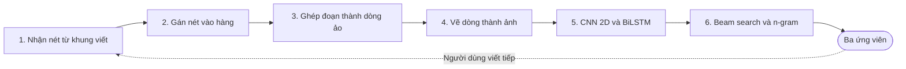

# Mô tả đề tài

Trạng thái: Nháp

Tài liệu này mô tả bối cảnh, mục tiêu, phạm vi và phương pháp tổng quát của đề tài nhận dạng chữ viết tay tiếng Việt trên thiết bị cảm ứng. Tài liệu dành cho giảng viên hướng dẫn và người thực hiện đề tài, và là nguồn chính của Chương 1 trong báo cáo. Các phần dữ liệu, thiết kế và đánh giá ở đây chỉ ở mức tổng quát, chi tiết nằm trong các tài liệu `02` đến `06`.

## 1. Tóm tắt

Đề tài xây dựng hệ thống nhận dạng chữ viết tay tiếng Việt theo dòng, chạy ngay trên thiết bị cảm ứng và cho phép ngắt dòng khi viết. Hệ thống nhận chuỗi nét từ khung viết, vẽ dòng thành ảnh rồi nhận dạng ảnh đó. Đầu ra là văn bản tiếng Việt có dấu.

Mô hình dự kiến gồm mạng nơ-ron tích chập hai chiều (CNN 2D), LSTM hai chiều (BiLSTM) và hàm mất mát Connectionist Temporal Classification (CTC). Mô hình huấn luyện trên bản ảnh của bộ dữ liệu HANDS-VNOnDB (VNOnDB). Lớp ghép đoạn đưa dòng ngắt về dạng dòng liền trước khi nhận dạng. Sản phẩm cuối là ứng dụng Android chạy không cần mạng, kèm mô hình đã nén, mã nguồn và báo cáo đánh giá.

## 2. Bối cảnh và lý do chọn đề tài

Tiếng Việt là trường hợp khó của nhận dạng chữ viết tay vì hệ thống dấu thanh và dấu phụ. Sáu nguyên âm gốc kết hợp với dấu thanh và dấu phụ tạo ra 66 nguyên âm biến thể [@vohtr2018a]. Dấu thanh và dấu phụ thường được viết sau phần thân chữ, tạo thành nét trễ [@nguyen2018]. Google cũng dùng riêng một mô hình cho tiếng Việt vì lượng dấu thanh và dấu phụ này [@carbune2019].

Đề tài có nền tảng tốt để triển khai vì đã có bộ dữ liệu công khai [@nguyen2018] và kết quả chuẩn từ cuộc thi nhận dạng chữ viết tay tiếng Việt dạng nét (VOHTR) tại Hội nghị quốc tế về nhận dạng chữ viết tay (ICFHR) 2018 [@le2018]. Khoảng trống còn lại là ràng buộc của thiết bị. Mô hình cho chữ viết tay dạng ảnh đứng đầu trên VNOnDB có 65,9 triệu tham số [@pham2025], quá lớn cho mục tiêu chạy trên điện thoại.

Điểm mới của đề tài là cho phép ngắt dòng. VNOnDB có 110.746 từ trên 7.296 dòng [@le2019], tức khoảng 15 từ mỗi dòng. Một dòng dài như vậy khó viết liền trên màn hình điện thoại hẹp.

## 3. Mục tiêu

Đề tài đạt yêu cầu khi mô hình đọc đúng dòng liền, giữ được độ chính xác khi dòng bị ngắt và chạy không cần mạng trên điện thoại. Chỉ số chính là tỷ lệ lỗi ký tự (CER) và tỷ lệ lỗi từ (WER). Đề tài đo thêm trên tập tự thu để biết kết quả khi viết bằng ngón tay. Ngưỡng định lượng và định nghĩa chỉ số nằm trong `02-yeu-cau-va-danh-gia.md`, mục 1 và mục 2.

## 4. Phạm vi

Hệ thống nhận dạng từng dòng văn bản tiếng Việt, và mỗi dòng được phép viết thành nhiều đoạn. Dòng ngắt là dòng viết không liền mạch: người viết dừng giữa chừng rồi viết tiếp, hoặc xuống hàng khi hết màn hình. Kết quả vẫn là một dòng văn bản liền, đúng thứ tự. Lớp ghép đoạn nối các đoạn thành dòng ảo, nên mô hình không cần biết dòng đã bị ngắt mấy lần.

### 4.1. Trong phạm vi

- Chữ viết bằng ngón tay hoặc bút cảm ứng trên điện thoại Android.
- Bộ ký tự của VNOnDB, gồm 161 ký tự [@pham2025].
- Ba kiểu ngắt: tạm dừng giữa dòng, xuống hàng khi hết màn hình, thêm dấu thanh hoặc dấu phụ sau khi đã dừng.
- Nhận dạng ngay trên thiết bị, không cần mạng.

### 4.2. Ngoài phạm vi

- Nhận dạng ảnh chụp chữ viết tay. Mô hình chỉ đọc ảnh do ứng dụng vẽ từ nét.
- Nhận dạng đoạn văn gồm nhiều dòng độc lập.
- Ngắt ở giữa một từ, vì đề tài giả định mỗi lần ngắt rơi vào ranh giới giữa hai từ.
- Viết chồng chữ lên nhau tại cùng một vị trí.
- Bản iOS và cá nhân hóa theo từng người viết.

## 5. Phát biểu bài toán

Bài toán là ánh xạ ảnh của một dòng thành một chuỗi ký tự, không cần căn chỉnh trước giữa cột ảnh và ký tự. Bảng 1 tóm tắt đầu vào, đầu ra và ràng buộc của bài toán.

Bảng 1: Phát biểu bài toán

| Thành phần | Mô tả |
| --- | --- |
| Đầu vào của hệ thống | Chuỗi nét theo thứ tự viết, mỗi nét là một dãy điểm $(x, y)$ |
| Đầu vào của mô hình | Ảnh xám của một dòng liền hoặc dòng ảo, do ứng dụng vẽ từ nét |
| Đầu ra | Chuỗi ký tự tiếng Việt, kèm ba ứng viên tốt nhất để người dùng chọn |
| Hàm mất mát | CTC, vì dữ liệu không có nhãn căn chỉnh theo từng cột ảnh [@graves2006] |
| Ràng buộc | Chạy không cần mạng trên điện thoại, theo `02-yeu-cau-va-danh-gia.md`, mục 1 |

## 6. Dữ liệu

Nguồn chính là VNOnDB, gồm 7.296 dòng từ 200 người viết [@nguyen2018; @le2018]. Các tệp nét gốc không tải được, nên đề tài dùng bản đã vẽ thành ảnh. Cách chia gồm 4.433 dòng huấn luyện, 1.229 dòng kiểm định và 1.634 dòng kiểm thử [@le2019]. Nhờ vậy, kết quả so sánh được với các công bố dạng ảnh.

Tập tự thu là nguồn dữ liệu nét duy nhất, với người viết không có trong VNOnDB. Tập này không dùng để huấn luyện, mà chia thành nhóm chỉnh ngưỡng và tập đánh giá. Chi tiết về nguồn, tiền xử lý, chống rò rỉ và quy trình thu nằm trong `03-du-lieu.md`.

## 7. Phương pháp

Hệ thống gồm hai phần: lớp ghép đoạn đưa dòng ngắt về dạng dòng liền, rồi mô hình CTC nhận dạng ảnh của dòng đó. Cách chia này cho phép huấn luyện mô hình trên VNOnDB, dù bộ dữ liệu không được thu cho kiểu viết xuống hàng. Hình 1 cho thấy luồng xử lý: ba bước đầu xử lý dòng ngắt, ba bước sau nhận dạng dòng ảo. Khi người dùng viết tiếp, ứng dụng chạy lại cả luồng trên mọi nét đã có.

Hình 1: Luồng xử lý một dòng ngắt

### 7.1. Xử lý dòng ngắt

Khung viết có hàng kẻ sẵn, nên mỗi nét được gán vào hàng gần tâm nét nhất. Lớp ghép đoạn nối các hàng thành một dòng ảo, đưa về cùng cỡ chữ và chèn khoảng cách chuẩn giữa các đoạn. Bước này dùng quy tắc hình học, không cần huấn luyện. Bảng 2 ghi cách xử lý từng kiểu ngắt.

Bảng 2: Các kiểu ngắt và cách xử lý

| Kiểu ngắt | Tác động lên dữ liệu vào | Cách xử lý |
| --- | --- | --- |
| Tạm dừng giữa dòng | Không đổi, vì ảnh không chứa thời gian | Nhận dạng lại sau mỗi lần dừng, chỉ chốt dòng khi người dùng bấm Xong |
| Xuống hàng khi hết màn hình | Các đoạn nằm trên nhiều hàng | Gán nét theo hàng rồi ghép thành dòng ảo |
| Thêm dấu thanh hoặc dấu phụ sau khi đã dừng | Xuất hiện nét trễ, viết sau nhưng nằm đúng chỗ trên hàng | Gán nét trễ vào đúng hàng, ảnh của dòng không phụ thuộc thứ tự viết |

Kiểu thứ ba không còn khó với mô hình, vì nét trễ nằm đúng chỗ trên ảnh. Phần khó chuyển sang bước gán nét vào hàng.

### 7.2. Tiền xử lý

Ứng dụng vẽ nét của dòng thành ảnh giống ảnh huấn luyện, chuyển về một kênh xám, rồi đưa vào khung rộng 512, cao 64 điểm ảnh (dự kiến). Tham số và quy tắc nằm trong `03-du-lieu.md`, mục 3.

### 7.3. Mô hình

Mô hình đề xuất gồm 4 khối CNN 2D, 2 lớp BiLSTM và lớp softmax trên 161 đầu ra, tức 160 ký tự có ở tập huấn luyện hoặc tập kiểm định và nhãn trống của CTC. CNN 2D giảm chiều cao 16 lần và chiều rộng 2 lần, còn 256 bước thời gian. Chiều rộng chỉ giảm 2 lần vì dòng dài nhất có 158 ký tự, và CTC cần số bước không ít hơn độ dài chuỗi đích. BiLSTM đọc ngữ cảnh theo cả hai chiều dọc dòng. Bảng 3 ghi ba mô hình, số tham số là ước tính theo cấu hình dự kiến.

Bảng 3: Các mô hình dự kiến

| Mô hình | Cấu hình | Số tham số ước tính | Vai trò |
| --- | --- | --- | --- |
| M0 | 4 khối CNN 2D (32, 64, 128 và 128 bộ lọc, kích thước 3) + 1 lớp kết nối đầy đủ 128 ô | 0,33 triệu | Mô hình cơ sở, không có BiLSTM |
| M1 | M0 + 2 lớp BiLSTM 128 ô | 1,00 triệu | Mô hình đề xuất |
| M2 | M1 + n-gram âm tiết | 1,00 triệu, chưa tính n-gram | Bản đưa lên điện thoại |

Theo ước tính, M1 chiếm khoảng 1,0 MB trọng số sau lượng tử hóa 8 bit, nên ngưỡng 20 MB còn nhiều chỗ cho mô hình ngôn ngữ. M1 có cỡ gần với GFCN, mốc nhỏ nhất có 1,4 triệu tham số [@pham2025]. So sánh M0 với M1 cho biết BiLSTM có đáng giữ không, vì mạng chỉ gồm CNN chạy nhanh hơn trên điện thoại. Đề tài dùng LSTM thay vì mạng hồi quy có cổng (GRU), vì tài liệu LiteRT chỉ nêu cách chuyển đổi sẵn cho lớp LSTM của Keras [@google2026d].

### 7.4. Huấn luyện

Mô hình được huấn luyện trực tiếp trên dữ liệu cấp dòng, vì dữ liệu cấp từ chưa phù hợp để huấn luyện theo `03-du-lieu.md`, mục 2.3. Cấu hình khởi đầu lấy từ Carbune và cộng sự: Adam, tốc độ học $10^{-4}$ và dropout 0,5 sau mỗi lớp LSTM [@carbune2019]. Cấu hình này được chọn lại trên tập kiểm định, vì đầu vào đã đổi sang ảnh. Mô hình tốt nhất được chọn theo CER trên tập kiểm định, và tập kiểm thử chỉ chạy một lần ở cuối.

### 7.5. Giải mã

Bộ giải mã dùng beam search CTC kết hợp n-gram âm tiết để chọn dấu thanh theo ngữ cảnh, ví dụ giữa "ma", "má" và "mà". Trọng số của n-gram được chỉnh trên tập kiểm định, vì mô hình quá tự tin trên dữ liệu huấn luyện [@carbune2019].

N-gram học từ văn bản của tập huấn luyện và một kho văn bản ngoài VieTreeBank. Lý do là toàn bộ văn bản của VNOnDB, kể cả tập kiểm thử, đều lấy từ VieTreeBank [@vohtr2018a]. Các câu trùng với tập kiểm thử phải được loại khỏi kho văn bản trước khi học.

### 7.6. Triển khai

Mô hình huấn luyện bằng Keras được chuyển sang định dạng `.tflite` và chạy trên Android bằng LiteRT [@google2026c]. Đề tài thử hai cách lượng tử hóa không cần tập hiệu chỉnh là dynamic range và float16 [@google2026e]. Bản float16 được chọn vì không làm tăng CER, còn dynamic range làm CER vượt ngưỡng. Kết quả nằm trong `07-nhat-ky-thi-nghiem.md`, mục 5.

Ứng dụng vẽ lại ảnh và nhận dạng lại cả dòng sau mỗi lần dừng, nên BiLSTM vẫn cho kết quả tạm thời trong lúc viết. Bước vẽ ảnh, bộ giải mã CTC và n-gram được viết bằng Kotlin.

## 8. Đánh giá

Kết quả chính là CER và WER trên ba kịch bản: dòng liền, ngắt mô phỏng và viết tay thật. Tập tự thu là thước đo cuối cùng cho dòng ngắt. Dung lượng và độ trễ được đo trên điện thoại Android thật. Kết quả được so với các mốc dạng ảnh trên VNOnDB, các hệ thống của cuộc thi VOHTR và ML Kit. Định nghĩa chỉ số, kịch bản và mốc so sánh nằm trong `02-yeu-cau-va-danh-gia.md`.

## 9. Sản phẩm đầu ra

Sản phẩm cuối là ứng dụng Android nhận dạng được dòng ngắt khi tắt mạng, kèm mô hình, mã nguồn và báo cáo đánh giá. Bảng 4 ghi điều kiện hoàn thành của từng sản phẩm.

Bảng 4: Sản phẩm đầu ra

| Sản phẩm | Nội dung | Điều kiện hoàn thành |
| --- | --- | --- |
| Ứng dụng Android | Khung viết có hàng kẻ, kết quả tạm thời, ba ứng viên | Nhận dạng được dòng ngắt khi tắt mạng |
| Mô hình | Tệp `.tflite`, bộ ký tự và mô hình ngôn ngữ | Đạt ngưỡng dung lượng trong `02-yeu-cau-va-danh-gia.md`, mục 1 |
| Mã nguồn | Tiền xử lý, vẽ ảnh, mô phỏng ngắt, huấn luyện, đánh giá, ứng dụng | Chạy lại được kết quả theo hướng dẫn |
| Tập tự thu | Nét viết tay và nhãn, không kèm thông tin cá nhân | Đủ số lượng dự kiến trong `03-du-lieu.md`, mục 6 |
| Báo cáo đánh giá | Kết quả ba kịch bản, phân tích lỗi dấu thanh và dấu phụ, so sánh với các mốc | Có số liệu cho mọi ngưỡng trong `02-yeu-cau-va-danh-gia.md`, mục 1 |
| Tài liệu bảo vệ | Slide và video minh họa dự phòng | Trình bày được cả khi ứng dụng gặp sự cố |

## 10. Kế hoạch

Đề tài chia thành bốn giai đoạn: dữ liệu, huấn luyện, triển khai và đánh giá. Mỗi giai đoạn kết thúc bằng một cổng kiểm tra đo được. Nội dung từng giai đoạn, từng cổng và tình trạng hiện tại nằm trong `08-cac-giai-doan.md`.

## 11. Rủi ro

Rủi ro lớn nhất nằm ở dữ liệu: mô hình học từ ảnh có sẵn của nét viết bút, nhưng được dùng với ảnh do ứng dụng vẽ từ nét ngón tay. Bảng 5 ghi các rủi ro, dấu hiệu nhận biết và hướng xử lý.

Bảng 5: Rủi ro và hướng xử lý

| Rủi ro | Dấu hiệu | Hướng xử lý |
| --- | --- | --- |
| Ảnh vẽ trên điện thoại lệch ảnh huấn luyện | CER trên nhóm chỉnh cao hơn nhiều so với CER kiểm định | Chỉnh độ dày nét và cách co ảnh, tăng cường làm dày hoặc mỏng nét |
| Lệch từ bút sang ngón tay | CER trên tập tự thu cao hơn nhiều so với VNOnDB | Mô phỏng nét ngón tay khi tăng cường, tinh chỉnh bằng dữ liệu của nhóm người viết khác |
| Quá khớp vì chỉ có 4.433 dòng | CER kiểm định cao hơn nhiều so với CER huấn luyện | Tăng cường ảnh, mô phỏng chỗ nối, giảm cỡ mô hình |
| Dòng dài bị co quá nhỏ | CER tăng theo độ dài dòng | Tăng chiều rộng khung ảnh, chọn lại trên tập kiểm định |
| Không đủ người cho nhóm chỉnh | Chưa chỉnh được ngưỡng lớp ghép đoạn | Giảm số người nhóm chỉnh, dùng thêm dòng ngắt mô phỏng |
| Lớp ghép đoạn kém ổn định | CER tăng thêm quá 2 điểm phần trăm khi dòng bị ngắt | Đổi sang khung viết cuộn ngang, không cần ghép hàng |
| Lỗi chuyển đổi hoặc lượng tử hóa | Không xuất được mô hình, hoặc CER tăng sau lượng tử hóa | Xuất thử từ giai đoạn 1, dùng float16, hoặc chuyển sang ONNX Runtime |
| Độ trễ vượt 1 giây với dòng dài | Thời gian đo trên điện thoại vượt ngưỡng | Giảm số lớp BiLSTM, thu nhỏ khung ảnh |
| Thiếu thời gian làm ứng dụng | Giai đoạn 3 chậm tiến độ | Thay bằng trang web có khung viết, chạy mô hình bằng ONNX Runtime Web |
