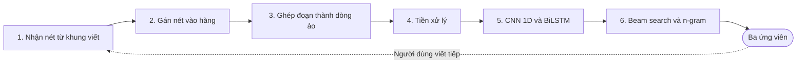

# Mô tả đề tài

Trạng thái: Nháp

Tài liệu này mô tả bối cảnh, mục tiêu, phạm vi và phương pháp tổng quát của đề tài nhận dạng chữ viết tay tiếng Việt trên thiết bị cảm ứng. Tài liệu dành cho giảng viên hướng dẫn và người thực hiện đề tài, và là nguồn chính của Chương 1 trong báo cáo. Các phần dữ liệu, thiết kế và đánh giá ở đây chỉ ở mức tổng quát, chi tiết sẽ nằm trong các tài liệu `02` đến `06`.

## 1. Tóm tắt

Đề tài xây dựng hệ thống nhận dạng chữ viết tay tiếng Việt theo dòng, chạy ngay trên thiết bị cảm ứng và cho phép ngắt dòng khi viết. Đầu vào là chuỗi nét gồm tọa độ và thứ tự viết, đầu ra là văn bản tiếng Việt có dấu.

Mô hình dự kiến gồm mạng nơ-ron tích chập một chiều (CNN 1D), LSTM hai chiều (BiLSTM) và hàm mất mát Connectionist Temporal Classification (CTC). Mô hình huấn luyện trên bộ dữ liệu HANDS-VNOnDB (VNOnDB). Lớp ghép đoạn đưa dòng ngắt về dạng dòng liền trước khi nhận dạng. Sản phẩm cuối là ứng dụng Android chạy không cần mạng, kèm mô hình đã nén, mã nguồn và báo cáo đánh giá.

## 2. Bối cảnh và lý do chọn đề tài

Tiếng Việt là trường hợp khó của nhận dạng chữ viết tay vì hệ thống dấu thanh và dấu phụ. Sáu nguyên âm gốc kết hợp với dấu thanh và dấu phụ tạo ra 66 nguyên âm biến thể [@vohtr2026a]. Dấu thanh và dấu phụ thường được viết sau phần thân chữ, tạo thành nét trễ [@nguyen2018]. Google cũng dùng riêng một mô hình cho tiếng Việt vì lượng dấu thanh và dấu phụ này [@carbune2019].

Đề tài có nền tảng tốt để triển khai vì đã có bộ dữ liệu công khai [@nguyen2018] và kết quả chuẩn từ cuộc thi nhận dạng chữ viết tay tiếng Việt dạng nét (VOHTR) tại Hội nghị quốc tế về nhận dạng chữ viết tay (ICFHR) 2018 [@le2018]. Khoảng trống còn lại là ràng buộc của thiết bị. Mô hình cho chữ viết tay dạng ảnh đứng đầu trên VNOnDB có 65,9 triệu tham số [@pham2025], quá lớn cho mục tiêu chạy trên điện thoại.

Điểm mới của đề tài là cho phép ngắt dòng. VNOnDB có 110.746 từ trên 7.296 dòng [@le2019], tức khoảng 15 từ mỗi dòng. Một dòng dài như vậy khó viết liền trên màn hình điện thoại hẹp.

## 3. Mục tiêu

Đề tài đạt yêu cầu khi mô hình đọc đúng dòng liền, giữ được độ chính xác khi dòng bị ngắt và chạy không cần mạng trên điện thoại. Bảng 1 ghi các ngưỡng dự kiến, có thể chỉnh lại sau khi có kết quả của mô hình cơ sở. Chỉ số chính là tỷ lệ lỗi ký tự (CER) và tỷ lệ lỗi từ (WER), định nghĩa ở mục 8.1.

Bảng 1: Mục tiêu và ngưỡng dự kiến

| Mục tiêu | Chỉ số | Ngưỡng dự kiến |
| --- | --- | --- |
| Nhận dạng dòng liền | CER trên tập kiểm thử VNOnDB cấp dòng | ≤ 10% |
| Nhận dạng dòng liền | WER trên tập kiểm thử VNOnDB cấp dòng | ≤ 25% |
| Xử lý dòng ngắt | CER tăng thêm so với cùng dòng viết liền | ≤ 2 điểm phần trăm |
| Chạy trên điện thoại | Tổng dung lượng mô hình và n-gram | ≤ 20 MB |
| Phản hồi nhanh | Thời gian nhận dạng một dòng trên điện thoại thật | ≤ 1 giây |
| Viết bằng ngón tay | CER trên tập tự thu | Đo và báo cáo |

Ngưỡng CER và WER nhắm thấp hơn mốc CNN + BiLSTM trong Bảng 7. Ngưỡng 20 MB ngang kích thước mô hình ML Kit cho mỗi ngôn ngữ [@google2026a].

## 4. Phạm vi

Hệ thống nhận dạng từng dòng văn bản tiếng Việt, và mỗi dòng được phép viết thành nhiều đoạn. Dòng ngắt là dòng viết không liền mạch: người viết dừng giữa chừng rồi viết tiếp, hoặc xuống hàng khi hết màn hình. Kết quả vẫn là một dòng văn bản liền, đúng thứ tự. Lớp ghép đoạn nối các đoạn thành dòng ảo, nên mô hình không cần biết dòng đã bị ngắt mấy lần.

### 4.1. Trong phạm vi

- Chữ viết bằng ngón tay hoặc bút cảm ứng trên điện thoại Android.
- Bộ ký tự của VNOnDB, gồm 161 ký tự [@pham2025].
- Ba kiểu ngắt: tạm dừng giữa dòng, xuống hàng khi hết màn hình, thêm dấu thanh hoặc dấu phụ sau khi đã dừng.
- Nhận dạng ngay trên thiết bị, không cần mạng.

### 4.2. Ngoài phạm vi

- Nhận dạng ảnh chụp chữ viết tay.
- Nhận dạng đoạn văn gồm nhiều dòng độc lập.
- Ngắt ở giữa một từ, vì đề tài giả định mỗi lần ngắt rơi vào ranh giới giữa hai từ.
- Viết chồng chữ lên nhau tại cùng một vị trí.
- Bản iOS và cá nhân hóa theo từng người viết.

## 5. Phát biểu bài toán

Bài toán là ánh xạ một chuỗi nét thành một chuỗi ký tự, không cần căn chỉnh trước giữa nét và ký tự. Bảng 2 tóm tắt đầu vào, đầu ra và ràng buộc của bài toán.

Bảng 2: Phát biểu bài toán

| Thành phần | Mô tả |
| --- | --- |
| Đầu vào | Chuỗi nét theo thứ tự viết, mỗi nét là một dãy điểm $(x, y)$ |
| Đầu ra | Chuỗi ký tự tiếng Việt, kèm ba ứng viên tốt nhất để người dùng chọn |
| Hàm mất mát | CTC, vì dữ liệu không có nhãn căn chỉnh theo từng điểm [@graves2006] |
| Ràng buộc | Chạy không cần mạng trên điện thoại, theo các ngưỡng trong Bảng 1 |

## 6. Dữ liệu

Nguồn chính là VNOnDB, gồm 1.146 đoạn văn, 7.296 dòng và hơn 480.000 nét từ 200 người viết [@nguyen2018; @le2018]. Đề tài dùng bản chia của cuộc thi VOHTR 2018, gồm 4.433 dòng huấn luyện, 1.229 dòng kiểm định và 1.634 dòng kiểm thử [@le2019]. Nhờ vậy, kết quả so sánh được với các công bố.

Ba đặc điểm của bộ dữ liệu chi phối thiết kế:

- **Chỉ có tọa độ:** mỗi điểm chỉ gồm $x$ và $y$, không có thời điểm [@vohtr2026a]. Đầu vào của mô hình vì thế không chứa thời gian dừng, nên người viết dừng lâu hay nhanh đều không làm đổi dữ liệu vào.
- **Thu bằng bút:** người viết dùng bút trên máy tính bảng Fujitsu ở 120 Hz [@iapr2026], khác với ngón tay trên điện thoại.
- **Giấy phép học thuật:** dữ liệu chỉ dành cho học thuật và nghiên cứu, muốn dùng thương mại phải liên hệ tác giả [@vohtr2026a].

Bảng 3 ghi vai trò của bốn nguồn dữ liệu. Hai tệp nén lấy từ trang của bộ dữ liệu [@iapr2026], quy mô của hai nguồn tự tạo là dự kiến.

Bảng 3: Các nguồn dữ liệu và vai trò

| Nguồn | Vai trò | Quy mô |
| --- | --- | --- |
| `InkData_line.zip` | Huấn luyện và kiểm thử chính | Tệp 239 MB |
| `InkData_word.zip` | Huấn luyện trước ở cấp từ | Tệp 246 MB |
| Dòng ngắt mô phỏng | Huấn luyện và kiểm thử lớp ghép đoạn | Sinh tự động từ VNOnDB |
| Dòng ngắt thật trong tập tự thu | Kiểm thử cuối trên điện thoại | 20 người, mỗi người 20 dòng |

Tập tự thu chỉ dùng để kiểm thử và lấy người viết không có trong VNOnDB. Người tham gia cần đồng ý trước, và dữ liệu không ghi thông tin cá nhân. Chi tiết về cách chia, tiền xử lý và quy trình thu nằm trong `03-du-lieu.md` (chưa viết).

## 7. Phương pháp

Hệ thống gồm hai phần: lớp ghép đoạn đưa dòng ngắt về dạng dòng liền, rồi mô hình CTC nhận dạng dòng đó. Cách chia này cho phép huấn luyện mô hình trên VNOnDB, dù bộ dữ liệu không được thu cho kiểu viết xuống hàng. Hình 1 cho thấy luồng xử lý: ba bước đầu xử lý dòng ngắt, ba bước sau nhận dạng dòng ảo. Khi người dùng viết tiếp, ứng dụng chạy lại cả luồng trên mọi nét đã có.

Hình 1: Luồng xử lý một dòng ngắt

### 7.1. Xử lý dòng ngắt

Khung viết có hàng kẻ sẵn, nên mỗi nét được gán vào hàng gần tâm nét nhất. Lớp ghép đoạn nối các hàng thành một dòng ảo, đưa về cùng cỡ chữ và chèn khoảng cách chuẩn giữa các đoạn. Bước này dùng quy tắc hình học, không cần huấn luyện. Bảng 4 ghi cách xử lý từng kiểu ngắt.

Bảng 4: Các kiểu ngắt và cách xử lý

| Kiểu ngắt | Tác động lên dữ liệu vào | Cách xử lý |
| --- | --- | --- |
| Tạm dừng giữa dòng | Không đổi, vì mô hình không dùng thời gian | Nhận dạng lại sau mỗi lần dừng, chỉ chốt dòng khi người dùng bấm Xong |
| Xuống hàng khi hết màn hình | Các đoạn nằm trên nhiều hàng | Gán nét theo hàng rồi ghép thành dòng ảo |
| Thêm dấu thanh hoặc dấu phụ sau khi đã dừng | Xuất hiện nét trễ cách xa chữ cái | Giữ thứ tự viết để mô hình xử lý như một nét trễ dài |

Kiểu thứ ba không phải trường hợp mới, vì VNOnDB đã có nét trễ dài, viết sau cả một câu [@vohtr2026a].

### 7.2. Tiền xử lý

- **Chuẩn hóa:** đưa chiều cao về khoảng từ 0 đến 1 và co giãn chiều ngang theo cùng tỷ lệ.
- **Lấy mẫu lại:** đặt các điểm cách đều dọc theo nét để giảm khác biệt giữa các thiết bị. Khoảng cách khởi đầu là 0,05 như Carbune và cộng sự [@carbune2019]. Nhóm này chuẩn hóa theo vùng viết chứ không theo chiều cao nét, nên giá trị phù hợp cho đề tài cần chọn lại bằng thí nghiệm.
- **Đặc trưng:** mỗi điểm có ba giá trị là $\Delta x$, $\Delta y$ và cờ bắt đầu nét.
- **Tăng cường dữ liệu:** co giãn, nghiêng, làm nhiễu nét và ghép các từ của tập huấn luyện thành dòng giả.

### 7.3. Mô hình

Mô hình đề xuất gồm 2 lớp CNN 1D, 3 lớp BiLSTM và lớp softmax trên 162 đầu ra, tức 161 ký tự và nhãn trống của CTC. CNN 1D giảm độ dài chuỗi 4 lần để mô hình chạy nhanh hơn. BiLSTM cần thiết vì chiều ngược đưa thông tin của nét trễ về đúng chữ cái. Bảng 5 ghi ba mô hình, số tham số là ước tính theo cấu hình dự kiến.

Bảng 5: Các mô hình dự kiến

| Mô hình | Cấu hình | Số tham số ước tính | Vai trò |
| --- | --- | --- | --- |
| M0 | 2 lớp BiLSTM 100 ô | 0,36 triệu | Mô hình cơ sở, cùng cỡ với IVTOV [@le2019] |
| M1 | 2 lớp CNN 1D (64 và 128 bộ lọc, kích thước 5) + 3 lớp BiLSTM 128 ô | 1,14 triệu | Mô hình đề xuất |
| M2 | M1 + n-gram âm tiết | 1,14 triệu, chưa tính n-gram | Bản đưa lên điện thoại |

Theo ước tính, M1 chiếm khoảng 1,1 MB trọng số sau lượng tử hóa 8 bit, nên ngưỡng 20 MB còn nhiều chỗ cho mô hình ngôn ngữ. So sánh M0 với M1 cho biết CNN 1D có đáng giữ không, vì Carbune và cộng sự không thấy lớp tích chập giúp ích trên dữ liệu lớn [@carbune2019]. Đề tài dùng LSTM thay vì mạng hồi quy có cổng (GRU), vì tài liệu LiteRT chỉ nêu cách chuyển đổi sẵn cho lớp LSTM của Keras [@google2026d].

### 7.4. Huấn luyện

Mô hình được huấn luyện trước trên dữ liệu cấp từ, rồi tinh chỉnh trên dữ liệu cấp dòng, theo cách của Le và cộng sự [@le2019]. Cấu hình khởi đầu lấy từ Carbune và cộng sự: Adam, tốc độ học $10^{-4}$ và dropout 0,5 sau mỗi lớp LSTM [@carbune2019]. Mô hình tốt nhất được chọn theo CER trên tập kiểm định, và tập kiểm thử chỉ chạy một lần ở cuối.

### 7.5. Giải mã

Bộ giải mã dùng beam search CTC kết hợp n-gram âm tiết để chọn dấu thanh theo ngữ cảnh, ví dụ giữa "ma", "má" và "mà". Trọng số của n-gram được chỉnh trên tập kiểm định, vì mô hình quá tự tin trên dữ liệu huấn luyện [@carbune2019].

N-gram học từ văn bản của tập huấn luyện và một kho văn bản ngoài VieTreeBank. Lý do là toàn bộ văn bản của VNOnDB, kể cả tập kiểm thử, đều lấy từ VieTreeBank [@vohtr2026a]. Các câu trùng với tập kiểm thử phải được loại khỏi kho văn bản trước khi học.

### 7.6. Triển khai

Mô hình huấn luyện bằng Keras được chuyển sang định dạng `.tflite` và chạy trên Android bằng LiteRT [@google2026c]. Bước đầu dùng lượng tử hóa dynamic range, vì cách này không cần tập hiệu chỉnh. Theo tài liệu LiteRT, cách này giảm dung lượng 4 lần và tăng tốc từ 2 đến 3 lần [@google2026e]. Sau bước này phải đo lại CER, vì lượng tử hóa có thể làm giảm độ chính xác.

Ứng dụng nhận dạng lại toàn bộ nét sau mỗi lần dừng, nên BiLSTM vẫn cho kết quả tạm thời trong lúc viết. Bộ giải mã CTC và n-gram được viết bằng Kotlin.

## 8. Đánh giá

Kết quả chính là CER và WER trên bốn kịch bản, trong đó tập tự thu là thước đo cuối cùng cho dòng ngắt. Định nghĩa chi tiết và quy trình đo sẽ nằm trong `02-yeu-cau-va-danh-gia.md` (chưa viết).

### 8.1. Chỉ số

$$
\mathrm{CER} = \frac{S + I + D}{N} \tag{1}
$$

trong đó $S$, $I$, $D$ là số ký tự bị thay, chèn và xóa, $N$ là số ký tự của chuỗi đúng. WER tính tương tự theo công thức (1), nhưng đơn vị là âm tiết thay cho ký tự.

- **CER bỏ dấu:** đo lại CER sau khi bỏ dấu thanh và dấu phụ ở cả hai chuỗi. Phần chênh so với CER thường cho biết tỷ lệ lỗi do dấu thanh và dấu phụ.
- **Dung lượng và độ trễ:** đo trên điện thoại Android thật, báo cáo trung vị và phân vị 95.

### 8.2. Kịch bản kiểm thử

Bảng 6 ghi bốn kịch bản kiểm thử và câu hỏi mỗi kịch bản cần trả lời.

Bảng 6: Kịch bản kiểm thử

| Kịch bản | Dữ liệu | Câu hỏi cần trả lời |
| --- | --- | --- |
| Dòng liền | 1.634 dòng kiểm thử của VNOnDB | Mô hình đứng ở đâu so với các mốc công bố? |
| Ngắt mô phỏng | Cùng 1.634 dòng, cắt 1-2 lần tại ranh giới từ | Lớp ghép đoạn làm CER tăng bao nhiêu? |
| Dấu thêm muộn | Cùng 1.634 dòng, chuyển nét dấu thanh và dấu phụ xuống cuối chuỗi | Mô hình có giữ được dấu thanh và dấu phụ khi nét trễ đến rất muộn? |
| Viết tay thật | Tập tự thu, mỗi người 10 dòng liền và 10 dòng ngắt | Kết quả có giữ được khi viết bằng ngón tay? |

Dòng ngắt mô phỏng phải có thêm lệch cỡ chữ và lệch đường chân chữ giữa các đoạn. Nếu chỉ dịch đoạn rồi ghép lại, lớp ghép đoạn sẽ trả về đúng dữ liệu gốc và kết quả đẹp giả tạo.

Ở tập tự thu, dòng liền được viết khi xoay ngang điện thoại, còn dòng ngắt được viết khi cầm dọc. Hai nhóm người viết đổi chéo nội dung để so sánh công bằng.

### 8.3. Mốc so sánh

Bảng 7 ghi các mốc so sánh, tất cả đều đo trên tập kiểm thử 1.634 dòng của VNOnDB. Các nguồn có thể tính trung bình theo cách khác nhau, nên số liệu chỉ mang tính tham khảo.

Bảng 7: Mốc so sánh trên tập kiểm thử VNOnDB

| Hệ thống | Dạng dữ liệu | CER (%) | WER (%) | Ghi chú |
| --- | --- | --- | --- | --- |
| MyScriptTask2_1 [@le2019] | Nét | 1,02 | 2,02 | Mô hình ngôn ngữ dùng VieTreeBank |
| IVTOVTask2 [@le2019] | Nét | 3,24 | 14,11 | 2 lớp BiLSTM 100 ô, ràng buộc từ điển lấy từ VieTreeBank |
| HTR-ConvText [@pham2025] | Ảnh | 3,45 | 8,9 | 65,9 triệu tham số |
| GoogleTask2 [@le2019] | Nét | 6,86 | 19,00 | Không huấn luyện trên VNOnDB [@carbune2019] |
| GFCN [@pham2025] | Ảnh | 8,4 | 24,2 | 1,4 triệu tham số |
| CNN + BiLSTM [@pham2025] | Ảnh | 10,53 | 29,1 | 8,3 triệu tham số |

MyScript và IVTOV khó làm mục tiêu vì cả hai đều dùng VieTreeBank, cùng nguồn với văn bản kiểm thử [@le2019]. MyScript dùng cho mô hình ngôn ngữ, còn IVTOV dùng cho ràng buộc từ điển. Cuộc thi còn có một tập kiểm thử riêng gồm 15 người viết mới [@vohtr2026b]. Trên tập này, CER của IVTOV tăng từ 3,2% lên 5,6%, và CER của Google tăng từ 6,9% lên 10,3% [@carbune2019]. Vì vậy, tập tự thu phải dùng người viết mới.

ML Kit có mô hình tiếng Việt với mã `vi` [@google2026b], nên đề tài chạy cùng tập tự thu trên ML Kit để có mốc thực tế nhất.

## 9. Sản phẩm đầu ra

Sản phẩm cuối là ứng dụng Android nhận dạng được dòng ngắt khi tắt mạng, kèm mô hình, mã nguồn và báo cáo đánh giá. Bảng 8 ghi điều kiện hoàn thành của từng sản phẩm.

Bảng 8: Sản phẩm đầu ra

| Sản phẩm | Nội dung | Điều kiện hoàn thành |
| --- | --- | --- |
| Ứng dụng Android | Khung viết có hàng kẻ, kết quả tạm thời, ba ứng viên | Nhận dạng được dòng ngắt khi tắt mạng |
| Mô hình | Tệp `.tflite`, bộ ký tự và mô hình ngôn ngữ | Đạt ngưỡng dung lượng trong Bảng 1 |
| Mã nguồn | Tiền xử lý, mô phỏng ngắt, huấn luyện, đánh giá, ứng dụng | Chạy lại được kết quả theo hướng dẫn |
| Tập tự thu | Nét viết tay và nhãn, không kèm thông tin cá nhân | Đủ số lượng dự kiến trong Bảng 3 |
| Báo cáo đánh giá | Kết quả bốn kịch bản, phân tích lỗi dấu thanh và dấu phụ, so sánh với các mốc | Có số liệu cho mọi ngưỡng trong Bảng 1 |
| Tài liệu bảo vệ | Slide và video minh họa dự phòng | Trình bày được cả khi ứng dụng gặp sự cố |

## 10. Kế hoạch

Đề tài chia thành bốn giai đoạn, mỗi giai đoạn kết thúc bằng một cổng kiểm tra đo được. Tỷ lệ thời gian giữa các giai đoạn là ước lượng thô, cần đổi sang tuần khi có hạn nộp. Cổng 1 chạy thử mô hình chưa huấn luyện trên điện thoại để phát hiện sớm lỗi chuyển đổi.

Nội dung từng giai đoạn và từng cổng: Chưa viết. Hình kế hoạch trong bản mô tả gốc không chép sang được, nên phần này sẽ được bổ sung khi có bản gốc.

## 11. Rủi ro

Rủi ro lớn nhất nằm ở dữ liệu: mô hình học từ bút trên máy tính bảng nhưng được dùng với ngón tay trên điện thoại. Bảng 9 ghi các rủi ro, dấu hiệu nhận biết và hướng xử lý.

Bảng 9: Rủi ro và hướng xử lý

| Rủi ro | Dấu hiệu | Hướng xử lý |
| --- | --- | --- |
| Lệch từ bút sang ngón tay | CER trên tập tự thu cao hơn nhiều so với VNOnDB | Mô phỏng nét ngón tay khi tăng cường, tinh chỉnh bằng dữ liệu của nhóm người viết khác |
| Quá khớp vì chỉ có 4.433 dòng | CER kiểm định cao hơn nhiều so với CER huấn luyện | Huấn luyện trước cấp từ, thêm dòng giả, tăng cường nét |
| Mất dấu thanh và dấu phụ khi nét trễ đến rất muộn | Kịch bản Dấu thêm muộn có CER tăng mạnh | Chèn nét trễ về sau chữ cái gần nhất, hoặc chuyển nét thành ảnh để bỏ ảnh hưởng của thứ tự viết |
| Lớp ghép đoạn kém ổn định | CER tăng thêm quá 2 điểm phần trăm khi dòng bị ngắt | Đổi sang khung viết cuộn ngang, không cần ghép hàng |
| Lỗi chuyển đổi hoặc lượng tử hóa | Không xuất được mô hình, hoặc CER tăng sau lượng tử hóa | Xuất thử từ giai đoạn 1, dùng float16, hoặc chuyển sang ONNX Runtime |
| Độ trễ vượt 1 giây với dòng dài | Thời gian đo trên điện thoại vượt ngưỡng | Giảm số lớp BiLSTM, tăng mức giảm độ dài chuỗi |
| Thiếu thời gian làm ứng dụng | Giai đoạn 3 chậm tiến độ | Thay bằng trang web có khung viết, chạy mô hình bằng ONNX Runtime Web |
