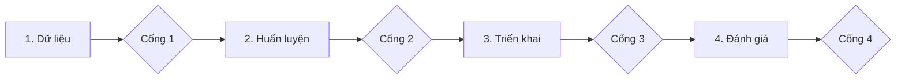

# Các giai đoạn của đề tài

Trạng thái: Nháp

Tài liệu này mô tả bốn giai đoạn thực hiện đề tài, gồm công việc, cổng kiểm tra và tình trạng hiện tại. Tài liệu dành cho giảng viên hướng dẫn và người thực hiện đề tài, dùng để theo dõi tiến độ và viết báo cáo tiến độ. Mọi tỷ lệ thời gian và ngưỡng trong tài liệu là giá trị dự kiến.

## 1. Tổng quan

Đề tài chia thành bốn giai đoạn, và mỗi giai đoạn kết thúc bằng một cổng kiểm tra đo được. Hình 1 cho thấy thứ tự các giai đoạn và các cổng.

Hình 1: Thứ tự các giai đoạn và cổng kiểm tra

Bảng 1 ghi tỷ lệ thời gian và điều kiện qua từng cổng. Tỷ lệ thời gian là ước lượng thô, đề tài sẽ đổi sang số tuần khi có hạn nộp. Giai đoạn 2 chiếm nhiều thời gian nhất, nhưng đề tài thử mô hình trên điện thoại ngay từ giai đoạn 1.

Bảng 1: Các giai đoạn, tỷ lệ thời gian và cổng kiểm tra

| Giai đoạn | Tỷ lệ thời gian (dự kiến) | Điều kiện qua cổng (dự kiến) |
| --- | --- | --- |
| 1. Dữ liệu | 20% | Cổng 1: mô hình học thuộc được 100 dòng với tỷ lệ lỗi ký tự (CER) trên chính các dòng đó ≤ 1%, và chạy được trên điện thoại thật |
| 2. Huấn luyện | 40% | Cổng 2: CER của M2 trên tập kiểm định ≤ 8,4% |
| 3. Triển khai | 25% | Cổng 3: chạy không cần mạng, thời gian nhận dạng mỗi dòng ≤ 1 giây |
| 4. Đánh giá | 15% | Cổng 4: đủ sản phẩm đầu ra theo `01-mo-ta-de-tai.md`, mục 9 |

## 2. Nội dung từng giai đoạn

Mỗi giai đoạn gồm một nhóm công việc và kết thúc bằng một cổng kiểm tra. Mục này chỉ ghi việc cần làm, còn quy định chi tiết nằm trong các tài liệu được dẫn chiếu.

### 2.1. Giai đoạn 1: Dữ liệu

Giai đoạn 1 chuẩn bị dữ liệu, dựng khung huấn luyện và thử sớm đường đi của mô hình lên điện thoại. Các công việc gồm:

- **Đọc dữ liệu:** đọc bản ảnh của bộ dữ liệu HANDS-VNOnDB (VNOnDB) và ba danh sách chia tập, theo `03-du-lieu.md`, mục 2.
- **Tiền xử lý:** chuẩn hóa nhãn, chuẩn hóa ảnh và tăng cường dữ liệu, theo `03-du-lieu.md`, mục 3.
- **Vẽ dòng thành ảnh:** viết bản Python của bước vẽ nét thành ảnh, theo `03-du-lieu.md`, mục 3.2.
- **Lớp ghép đoạn:** viết bước gán nét vào hàng và bước ghép các đoạn thành dòng ảo, theo `01-mo-ta-de-tai.md`, mục 7.1.
- **Bộ mô phỏng dòng ngắt:** sinh dòng ngắt từ dòng liền của tập tự thu, theo `03-du-lieu.md`, mục 4. Dữ liệu cho bước này lấy từ nhóm chỉnh, nên nhóm chỉnh được thu ngay trong giai đoạn 1.
- **Khung huấn luyện:** viết mã huấn luyện và mã tính chỉ số, theo `02-yeu-cau-va-danh-gia.md`, mục 2.
- **Chạy thử trên điện thoại:** chuyển mô hình chưa huấn luyện sang `.tflite` và chạy trên điện thoại thật.

Cổng 1 yêu cầu mô hình học thuộc được 100 dòng, với CER trên chính 100 dòng đó không quá 1%, và chạy được trên điện thoại thật. Phép học thuộc kiểm tra khung huấn luyện. Phép chạy thử phát hiện sớm lỗi chuyển đổi.

### 2.2. Giai đoạn 2: Huấn luyện

Giai đoạn 2 tìm mô hình tốt nhất trên bản ảnh của VNOnDB, theo CER trên tập kiểm định. Các công việc gồm:

- **Huấn luyện cấp dòng:** huấn luyện trực tiếp trên dữ liệu cấp dòng, theo `01-mo-ta-de-tai.md`, mục 7.4.
- **So sánh mô hình:** so sánh M0, M1 và M2, theo `01-mo-ta-de-tai.md`, mục 7.3. Phép so sánh M0 với M1 cho biết LSTM hai chiều (BiLSTM) có đáng giữ không.
- **Mô hình ngôn ngữ:** học n-gram âm tiết và chỉnh trọng số trên tập kiểm định, theo `01-mo-ta-de-tai.md`, mục 7.5.
- **Bộ giải mã tham chiếu:** viết bản Python của bộ giải mã, làm chuẩn để đối chiếu bản Kotlin, theo `02-yeu-cau-va-danh-gia.md`, mục 5.
- **Phân tích lỗi:** đo tỷ lệ lỗi bỏ dấu để biết phần lỗi do dấu thanh và dấu phụ, theo `02-yeu-cau-va-danh-gia.md`, mục 2.3.

Cổng 2 yêu cầu CER của M2 trên tập kiểm định không quá 8,4%, bằng ngưỡng cuối trong `02-yeu-cau-va-danh-gia.md`, mục 1. Đề tài chọn mức này thay cho 10%, vì qua cổng ở mức 10% vẫn có thể không đạt ngưỡng cuối.

### 2.3. Giai đoạn 3: Triển khai

Giai đoạn 3 đưa mô hình lên điện thoại và thu dữ liệu viết bằng ngón tay. Các công việc gồm:

- **Lượng tử hóa:** chuyển mô hình đã huấn luyện sang `.tflite`, lượng tử hóa rồi đo lại CER, theo `01-mo-ta-de-tai.md`, mục 7.6.
- **Ứng dụng Android:** làm khung viết có hàng kẻ, kết quả tạm thời và ba ứng viên, theo `01-mo-ta-de-tai.md`, mục 9.
- **Mã trên điện thoại:** đưa lớp ghép đoạn vào ứng dụng, viết bước vẽ dòng thành ảnh và bộ giải mã bằng Kotlin, theo `01-mo-ta-de-tai.md`, mục 7.6.
- **Đối chiếu hai bản:** kiểm tra bản Kotlin cho cùng kết quả với bản Python trên một bộ mẫu chung, theo `02-yeu-cau-va-danh-gia.md`, mục 5 và `03-du-lieu.md`, mục 3.
- **Thu tập tự thu:** thu tập đánh giá viết bằng ngón tay, theo `03-du-lieu.md`, mục 6. Nhóm chỉnh đã thu ở giai đoạn 1.
- **Chỉnh ngưỡng:** chỉnh ngưỡng của lớp ghép đoạn và độ dày nét trên nhóm chỉnh, theo `03-du-lieu.md`, mục 5.

Cổng 3 yêu cầu ứng dụng chạy không cần mạng và nhận dạng mỗi dòng trong không quá 1 giây (dự kiến). Cách đo độ trễ nằm trong `02-yeu-cau-va-danh-gia.md`, mục 2.5.

### 2.4. Giai đoạn 4: Đánh giá

Giai đoạn 4 đo kết quả cuối và hoàn thiện các sản phẩm đầu ra. Các công việc gồm:

- **Chạy ba kịch bản:** chạy Dòng liền, Ngắt mô phỏng và Viết tay thật một lần ở cuối, theo `02-yeu-cau-va-danh-gia.md`, mục 3 và mục 5.
- **So sánh với các mốc:** so kết quả với các mốc công bố và ML Kit, theo `02-yeu-cau-va-danh-gia.md`, mục 4.
- **Viết báo cáo:** viết báo cáo đánh giá và báo cáo cuối kỳ, theo `00-quy-tac-viet-tai-lieu.md`, mục 13.1.
- **Làm tài liệu bảo vệ:** làm slide và video minh họa dự phòng.

Cổng 4 yêu cầu đủ các sản phẩm đầu ra, theo `01-mo-ta-de-tai.md`, mục 9.

## 3. Tình trạng đến ngày 25/11/2026

Đề tài đã có bản chạy trọn luồng từ khung viết đến ba ứng viên. Ngày 24/11/2026, ứng dụng chạy được trên điện thoại thật, theo `06-trien-khai-android.md`, mục 3.3, nên Cổng 1 đạt cả phần học thuộc, với CER 0%, và phần điện thoại thật. Cổng 2 đạt trên tập kiểm định với cấu hình triển khai. Trên tập kiểm thử VNOnDB, chạy một lần ngày 24/11/2026, CER của M2 là 5,97%, cũng dưới ngưỡng 8,4%, theo `07-nhat-ky-thi-nghiem.md`, mục 12.1.

Mô hình trong ứng dụng nay là `m1l_rr_e100`, dùng M1 lớn, với CER của M2 trên tập kiểm định là 6,61%, so với 8,22% của `m1_v2` dùng trước đó. Lần chạy thử 150 epoch ngày 13/11/2026 không đạt cách chọn đã chốt trước ở `07-nhat-ky-thi-nghiem.md`, mục 10.11, nên mô hình này được giữ. Sau đợt thu thứ hai ngày 16/11/2026, nhóm chỉnh viết bằng ngón tay có 9 buổi đủ điều kiện, với CER của M2 là 14,60% ở dòng ngắt sau khi ghép và 12,43% ở dòng liền, theo mục 10.13 của tài liệu đó. Ngày 23/11/2026, bộ lọc nét lạc hạ CER của dòng liền xuống 10,75% nhưng làm tăng CER ở dòng ngắt mô phỏng của buổi thử ngón tay, nên không được nhận, theo mục 10.15 đến mục 10.17. Ngày 24/11/2026, đề tài chốt cấu hình và dùng 19 buổi của đợt thu thứ ba làm tập đánh giá viết bằng ngón tay, với CER của M2 là 14,69% ở dòng ngắt sau khi ghép và 10,34% ở dòng liền, theo mục 10.19 và mục 12.2.

Trên nét viết thật của sáu người viết bằng bút, CER của M2 giảm từ 20,28% xuống 14,33% với dòng ngắt sau khi ghép, và từ 26,80% xuống 19,02% với dòng liền, theo `07-nhat-ky-thi-nghiem.md`, mục 10.7 và mục 10.8. Với ngón tay, CER của M2 ở dòng liền trên tập đánh giá cao hơn tập kiểm thử VNOnDB 4,37 điểm phần trăm, theo `07-nhat-ky-thi-nghiem.md`, mục 12.2. Trạng thái của từng tài liệu nằm trong `README.md`. Tình trạng cụ thể như sau:

- **Dữ liệu và công cụ đã có:** bản ảnh VNOnDB, thống kê dữ liệu trong `03-du-lieu.md`, mục 2.1, kho văn bản Wikipedia, công cụ thu nét `tools/thu-net/` và nét viết thật của hai buổi thử, gồm 6 người viết bằng bút S Pen. Công cụ thu đã có sẵn câu đề của nhóm chỉnh và nhóm kiểm thử. Ngày 11/11/2026 có thêm ba buổi viết bằng ngón tay của 2 người, nhưng các buổi này chưa đúng quy trình nên chỉ dùng như buổi thử, theo `07-nhat-ky-thi-nghiem.md`, mục 10.10. Ngày 12/11/2026, công cụ thu được sửa để tránh các lỗi của những buổi này: tự cấp mã ẩn danh, khóa câu đề, cỡ hàng và cách nhập của đợt chính thức, tự tìm chiều rộng màn hình hoặc đo bằng thẻ, và bắt buộc rà soát từng dòng trước khi xuất tệp. Mẫu phiếu đồng ý nằm ở `tools/thu-net/phieu-dong-y.md`, theo `03-du-lieu.md`, mục 6. Tập tự thu viết bằng ngón tay gồm nhóm chỉnh 9 buổi và tập đánh giá 19 buổi, theo `07-nhat-ky-thi-nghiem.md`, mục 10.19. Ngày 23/11/2026, công cụ thu được sửa tiếp: dòng liền ở màn rà soát hiện thành nhiều đoạn đọc được, rà quá nhanh thì bị nhắc, người viết lại phải dùng mã cũ, và bảng máy có thêm các đời Galaxy A cũ, theo mục 10.14 của tài liệu đó. Bản này chưa được đăng lên đường link.
- **Mã đã có trong `training/`:** đọc dữ liệu, tiền xử lý ảnh, tăng cường dữ liệu, mô hình M0, M1 và M1 lớn, vòng huấn luyện, tính chỉ số, chuyển đổi sang LiteRT, n-gram âm tiết, bộ giải mã tham chiếu, lớp ghép đoạn, bước vẽ dòng thành ảnh, bộ mô phỏng dòng ngắt, mã đánh giá tệp tự thu, và n-gram ký tự cùng bộ giải mã thử nghiệm dùng nó.
- **Mã đã có trong `android/`:** khung viết, lớp ghép đoạn, bước vẽ ảnh, chạy mô hình, bộ giải mã và phép đối chiếu với Python. Ứng dụng đã chạy trên máy ảo và trên điện thoại thật với mô hình `m1l_rr_e100`, theo `06-trien-khai-android.md`, mục 3.
- **Giai đoạn 1:** đã xong. Phần chạy thử trên điện thoại thật đạt ngày 24/11/2026.
- **Giai đoạn 2:** đã xong. Các thí nghiệm của `05-ke-hoach-thi-nghiem.md`, mục 3 đã xong, gồm cả M0 và phép đo độ dao động giữa các hạt giống. Mô hình được chọn là M1 lớn huấn luyện 100 epoch, theo `07-nhat-ky-thi-nghiem.md`, mục 10.9, và $\alpha$, $\beta$ đã được chỉnh lại cho mô hình này. Bước 6 kết thúc ngày 24/11/2026 với cấu hình giữ nguyên, theo mục 10.19 của tài liệu đó.
- **Giai đoạn 3 và giai đoạn 4:** ba kịch bản kiểm thử đã chạy ngày 24/11/2026, theo `07-nhat-ky-thi-nghiem.md`, mục 12. Cùng ngày, bản báo cáo cuối kỳ được dựng ở thư mục `bao-cao/`, gồm năm chương, kết luận và tài liệu tham khảo, theo định dạng báo cáo đồ án. Lệnh `bao-cao/cong-cu/dung-bao-cao.ps1` dựng lại tệp Word và PDF từ các tệp trong `bao-cao/noi-dung/`. Tệp Word, gói mã nguồn và gói tập dữ liệu tự thu được gom vào thư mục `nop-do-an/`. Gói dữ liệu chỉ ghi mã người viết và không kèm phiếu đồng ý, vì phiếu có họ tên. Còn đo độ trễ trên điện thoại thật, điền trang bìa của báo cáo và làm tài liệu bảo vệ.
- **Phân tích sau khi chốt cấu hình:** ngày 25/11/2026, đề tài đo phần lỗi mà mô hình ngữ cảnh có thể sửa và thử thêm n-gram ký tự vào bộ giải mã, chỉ trên tập kiểm định và nhóm chỉnh, theo `07-nhat-ky-thi-nghiem.md`, mục 13 và mục 14. Bản n-gram ký tự 4,10 MB vừa ngưỡng 20 MB, giảm CER của M2 trên nhóm chỉnh từ 13,48% xuống 10,80%, và đã được đưa vào ứng dụng cùng ngày, theo mục 14.5 của tài liệu đó. Kết quả cuối ở mục 12 vẫn là của cấu hình đã chốt.
- **So sánh với ML Kit:** đã chạy trên máy ảo ngày 25/11/2026, theo `07-nhat-ky-thi-nghiem.md`, mục 15. Trên tập đánh giá, ML Kit nhận dòng ảo của lớp ghép đoạn có CER 6,33%, so với 12,58% của cấu hình đã chốt, còn ML Kit đọc nét gốc có CER 36,61% với dòng ngắt. Còn đo độ trễ trên điện thoại thật bằng bài đo ở `06-trien-khai-android.md`, mục 3.4.

## 4. Vấn đề chưa chốt

Bảng 2 ghi các điểm cần quyết định để hoàn chỉnh kế hoạch. Các vấn đề riêng về đánh giá và dữ liệu nằm trong `02-yeu-cau-va-danh-gia.md`, mục 6 và `03-du-lieu.md`, mục 7.

Bảng 2: Các vấn đề chưa chốt về kế hoạch

| Vấn đề | Ảnh hưởng | Hướng đề xuất |
| --- | --- | --- |
| Thời lượng từng giai đoạn | Chưa lập được lịch theo tuần | Đổi tỷ lệ thời gian sang số tuần khi biết hạn nộp |
| Mô hình chỉ học từ VNOnDB đọc nét viết thật kém | Ứng dụng có thể không dùng được dù đạt Cổng 2 | Ảnh vẽ lại, M1 lớn và huấn luyện 100 epoch đã giảm CER trên nét viết thật, theo `07-nhat-ky-thi-nghiem.md`, mục 10.5 và mục 10.8. Nếu vẫn chưa đủ trên nhóm chỉnh, thu thêm một nhóm người viết để tinh chỉnh mô hình, việc này cần đổi quy định ở `03-du-lieu.md`, mục 6 |
